# SteamLike 手柄控制器

> Android 手柄 → 键盘/鼠标映射器，专为在 Winlator 中游玩 WoW 乌龟服 1.18.1 设计。
>
> 参考 [InputBridge](https://inputbridge.cloud/) 的架构，采用 **Android TCP服务器 + Windows SendInput客户端** 的桥接方案。
>
> 灵感来自 Steam Input API 的 Action Set Layer 与 Sub-Command 机制，采用 **操作集 + 公共层 + 10个操作层 + 子命令组合键** 架构。
>
> 无需 Root / 无需 Shizuku：通过 **悬浮窗焦点窗口** 直接接收 Android 系统分发的 `KeyEvent` / `MotionEvent`。

---

## 目录

- [项目简介](#项目简介)
- [核心特性](#核心特性)
- [架构设计](#架构设计)
- [快速开始](#快速开始)
- [Windows配套程序](#windows配套程序)
- [编译流程](#编译流程)
- [按键映射](#按键映射)
- [子命令机制](#子命令机制)
- [操作集](#操作集)
- [10个操作层](#10个操作层)
- [操作层触发机制](#操作层触发机制)
- [快捷键](#快捷键)
- [悬浮窗 UI](#悬浮窗-ui)
- [设置界面](#设置界面)
- [运行时配置 API](#运行时配置-api)
- [配置文件](#配置文件)
- [项目结构](#项目结构)
- [入口点](#入口点)
- [线程模型](#线程模型)
- [模块说明](#模块说明)
- [类图 (PlantUML)](#类图-plantuml)
- [数据结构](#数据结构)
- [Android API 说明](#android-api-说明)
- [测试目录](#测试目录)
- [技术原理](#技术原理)
- [通信协议](#通信协议)
- [依赖说明](#依赖说明)
- [常见问题](#常见问题)

---

## 项目简介

本应用将 Android 手柄输入实时转换为键盘/鼠标事件，通过TCP桥接发送给运行在 Winlator 内的 Windows 配套程序，由 Windows 程序使用 `SendInput()` API 注入到游戏窗口。

**核心创新**:
- **桥接架构**: Android端(TCP服务器) ←→ Windows端(SendInput注入)，参考InputBridge设计
- **ControllerProfile 配置模型**: 由 `多个操作集（每个含 公共层 + 10个操作层） + 全局设置` 组成的完整配置，所有按键映射以 `KeyMapping` 表示
- **操作集 (Action Set)**: 位于操作层之上，切换操作集时其下所有操作层整体切换；每个操作集可自定义名称，支持添加/删除/拷贝（拷贝时可直接改名）
- **操作层触发机制**: 公共层通过 `SwitchLayer` 映射绑定触发键（如 D-Pad ↑→Layer1），按住触发键激活对应层、松开回到公共层
- **子命令组合键(Sub-Command)**: 每个 `KeyMapping` 可附加最多 3 个子命令，实现 `Alt+3`、`Ctrl+Shift+3` 等组合键
- **无 Root/无 Shizuku**: 通过悬浮窗焦点窗口直接接收系统 `KeyEvent` / `MotionEvent`，无需任何特权框架

### 适用场景

- 在 Android 设备上通过 Winlator 运行 WoW 乌龟服 1.18.1
- 使用 Xbox/PS/Switch 等手柄进行游戏
- 需要不同场景下的不同按键映射（战斗/骑乘/瞄准/拾取等）

---

## 核心特性

- **桥接注入架构**: Android TCP服务器 + Windows SendInput客户端，参考InputBridge
- **ControllerProfile 配置**: 多个操作集（含 公共层 + 10个操作层）+ GlobalSettings 统一管理
- **操作集管理**: 添加/删除/切换/拷贝操作集，拷贝时可直接改名；切换操作集时其下所有操作层整体切换
- **操作层触发机制**: 公共层 SwitchLayer 映射驱动，按住触发键激活对应层、松开回公共层
- **子命令组合键**: 每个 KeyMapping 可附加最多 3 个子命令，实现 Alt+3、Ctrl+Shift+3 等组合键
- **配置文件导入/导出**: version=3 JSON 格式（自动兼容 version=2 旧配置），支持导出当前配置、导入自定义配置、自动持久化
- **设置界面**: LayerEditActivity 提供可视化编辑操作集、操作层、按键映射、子命令
- **焦点窗口捕获手柄**: 通过全屏透明悬浮窗获取焦点，直接接收系统 `KeyEvent`/`MotionEvent`，无需 Root/Shizuku
- **多手柄类型支持**: Xbox/PS/Switch/Steam Controller 自动识别和按键修正
- **摇杆精细控制**: 统一 GlobalSettings 管理死区(deadzone)、视角灵敏度(lookSensitivity)、光标速度(cursorSpeed)
- **运行时配置**: 可动态修改任意操作层的按键映射
- **悬浮窗 UI**: 收起状态显示当前激活层名，展开状态显示所有层名并高亮激活层
- **震动反馈**: 层切换时的触觉反馈
- **单进程限制**: Windows 客户端使用命名互斥锁确保单实例运行
- **智能暂停**: 检测前台应用（UsageStats），仅当 Winlator 等白名单应用在前台时保持手柄捕获，切到其他应用自动移除焦点窗口，解决 Android 13+ 焦点悬浮窗导致右滑返回失效的问题（默认白名单含 `com.winlator`、`com.winlator.hub`，可在 App 内增删）
- **捕获开关双向同步**: 悬浮窗"暂停/恢复捕获"按钮与 App 内"手柄捕获"开关实时同步（广播 + 持久化）
- **悬浮窗主页按钮**: 一键拉起手机桌面（切出游戏）
- **悬浮窗层名动态同步**: 悬浮窗层按钮显示 App 内配置的层名（在设置界面重命名后自动同步；未重命名的层显示预设中文名）
- **桌面控制面板**: Windows 客户端自带 egui 界面（基本设置 / 按键映射 / 日志），无需命令行参数
- **内置导出**: APK 内置 `inputbridge_client.exe` 与 `version.txt`，一键导出到 Download/AControler
- **自动重连**: Windows客户端断线自动重连
- **自动编译 exe**: build.gradle.kts 的 `compileWindowsExe` task 在 APK 编译前自动编译 Windows exe 并打包到 assets

---

## 架构设计

### 整体架构（桥接模式 + 焦点窗口）

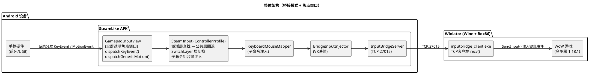

### 数据流（含子命令注入）

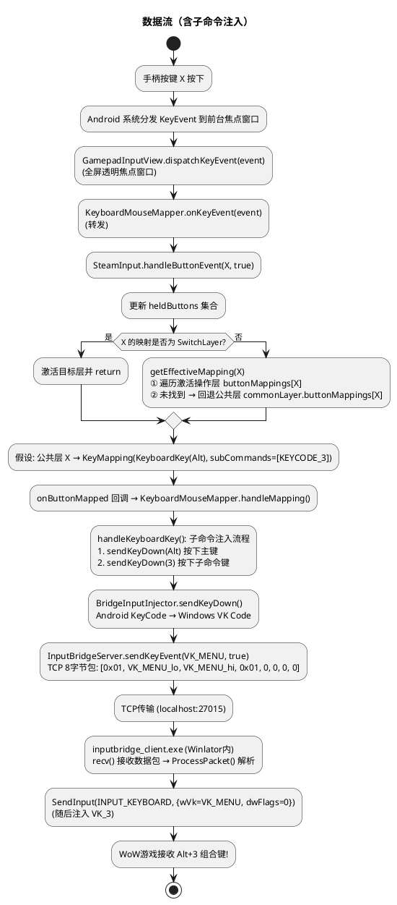

### 公共层 + 操作层架构

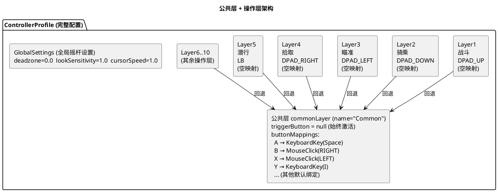

### 按键查询顺序（激活层 → 公共层回退）

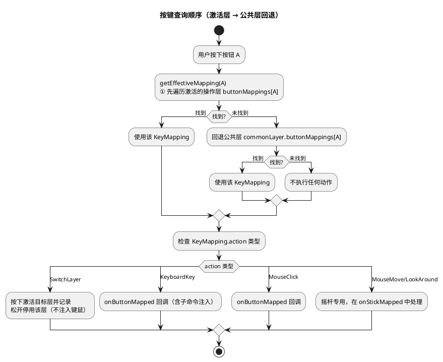

---

## 快速开始

### 环境要求

- Android 7.0 (API 24) 或更高（推荐 Android 8.0+ 以使用 `TYPE_APPLICATION_OVERLAY`）
- 蓝牙/USB 手柄
- Winlator（用于运行 WoW）
- Rust 工具链 cargo（可选，仅自行编译 Windows 配套程序时需要；APK 编译会自动调用）

### 第一步: Android端安装

1. **编译安装本应用**
   ```bash
   # 在 Android Studio 中打开 l:\steamlike 项目
   # 或使用 Gradle 命令行:
   ./gradlew assembleDebug
   adb install app/build/outputs/apk/debug/app-debug.apk
   ```

2. **配置权限**
   - 打开 SteamLike 控制器应用
   - 点击"授予悬浮窗权限" → 允许显示在其他应用上层
   - （可选）授予前台服务通知权限（Android 13+）

3. **启动映射**
   - 点击"启动手柄映射"
   - 悬浮窗显示"等待Windows客户端连接... (端口27015)"
   - 焦点输入窗口已自动创建并请求焦点，可接收手柄事件

### 第二步: 获取Windows配套程序

**方式1: 从APK内导出（推荐，无需编译）**

1. 在 SteamLike 控制器主界面点击"导出 Windows 客户端到 Download/AControler"
2. 文件会导出到 `/sdcard/Download/AControler/` 目录：
   - `inputbridge_client.exe` - Windows 客户端（Rust + egui）
   - `version.txt` - 版本号（客户端启动时读取第一行显示）
3. 通过文件管理器或 ADB 取出这两个文件

> **说明**: APK 编译时 `compileWindowsExe` task 会调用 `cargo build --release` 编译 Rust 客户端并打包到 assets；cargo 不可用时沿用 assets 中已有的 exe。

**方式2: 自行编译**

```bash
# 进入 Rust 工程目录
cd windows/rust_client

# 编译 release 版
cargo build --release
# 产物: target/release/inputbridge_client.exe
```

### 第三步: 在Winlator中运行

1. **复制程序到Winlator**
   - 将 `inputbridge_client.exe` 和 `version.txt` 复制到 Winlator 的虚拟C盘
   - 通常路径: `Winlator容器内部 → C:\`

2. **启动顺序**
   ```
   ① 打开 SteamLike 控制器 → 授予悬浮窗权限 → 启动手柄映射
   ② 切换到 Winlator → 运行 inputbridge_client.exe
   ③ 启动 WoW 游戏
   ```

3. **验证连接**
   - Windows客户端面板状态显示「已连接 127.0.0.1:27015」
   - Android主界面显示 `Client: connected`
   - 按手柄按键，WoW游戏有响应 = 成功
   - 若手柄无响应，请点击悬浮窗区域使焦点窗口重新获取焦点

### 使用流程

```
打开 SteamLike 控制器
      ↓
授予悬浮窗权限
      ↓
点击"启动手柄映射" → 悬浮窗显示"等待连接"
      ↓
（可选）点击"操作层设置" → 自定义按键映射/触发键/层名
      ↓  注: 进入设置界面时悬浮窗自动隐藏，退出后恢复
切换到 Winlator → 运行 inputbridge_client.exe
      ↓
客户端面板显示「已连接」 → 启动 WoW 游戏
      ↓
按住 D-Pad 上/下/左/右 等触发键激活对应操作层（松开回公共层）
      ↓
（若手柄无响应）点击屏幕使焦点窗口重新获取焦点
```

---

## Windows配套程序

### inputbridge_client.exe

运行在 Winlator 内的 Rust GUI 程序（egui），负责：
1. 连接 Android 端的 TCP 服务器（localhost:27015），断线自动重连
2. 接收 8 字节定长数据包（完整消息表见 [docs/protocol.md](docs/protocol.md)）
3. 解析数据包并通过 `SendInput()` 注入键盘/鼠标事件
4. 可选安装低级键鼠钩子，在 Windows 侧做本地按键映射（WASD 自动锁定右键、交互键序列、长按交换等）
5. 读取 `SLState` WoW 插件维护的角色状态，供「仅潜行 / 仅非潜行」等映射条件使用
6. 剪贴板同步：游戏内复制的文本追加到 `clipboard_log.txt`，已连接时同时发回手机剪贴板

### 编译方式

| 方式 | 命令 | 依赖 |
|------|------|------|
| Gradle 自动编译 | `./gradlew assembleDebug`（自动触发 compileWindowsExe） | cargo（可选） |
| 手动编译 | `cd windows/rust_client && cargo build --release` | Rust 工具链 |

### 启动方式

程序无命令行参数，直接运行：

```bash
inputbridge_client.exe
```

服务器地址/端口在「基本设置」页配置，保存在 exe 同目录的 `rust_client_config.json`。

### 程序特性

- **单进程限制**: 使用命名互斥锁 `Global\SteamLikeInputBridgeClient` 确保同时只有一个实例运行，重复启动会提示并退出
- **自动重连**: 连接断开后 1~2 秒自动重试，服务器地址改动后立即按新地址重连
- **状态跟踪**: 跟踪所有按下的键和按钮，断开或退出时自动释放，防止按键卡住
- **浮动控制面板**: 无边框置顶窗口，可在「圆点 / 小面板 / 完整面板」三种形态间切换
- **文件日志**: exe 同目录 `inputbridge_client.log`，同时显示在「日志」页
- **版本自检**: 读取同目录 `version.txt` 显示版本，并与 APK 下发的期望版本比对，不一致时提示重新导出客户端

---

## 编译流程

### compileWindowsExe Task

[build.gradle.kts](app/build.gradle.kts) 中定义了 `compileWindowsExe` Gradle task，在 APK 编译前自动编译 Rust 客户端 `inputbridge_client.exe` 并复制到 assets 目录，确保 APK 内置的 exe 与 Rust 源码同步。

#### 工作流程

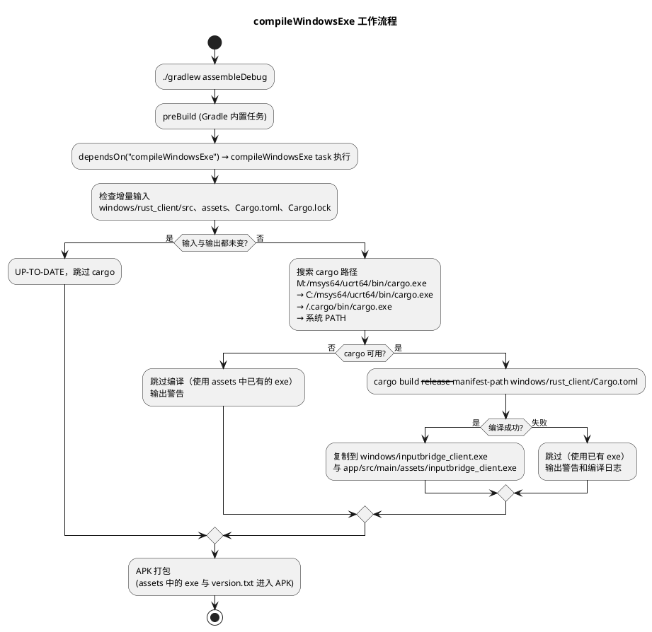

#### 关键代码

```kotlin
tasks.register("compileWindowsExe") {
    group = "build"
    description = "Builds Windows inputbridge_client.exe (Rust) and copies it to assets"
    // ... 搜索 cargo，执行 cargo build --release，复制到 windows/ 与 assets
}

// 在 preBuild 前执行编译
tasks.named("preBuild") {
    dependsOn("compileWindowsExe")
}
```

#### 设计说明

- **容错性**: cargo 不可用或编译失败时不会中断 APK 构建，而是使用 assets 中已有的 exe（会输出警告）
- **增量构建**: 声明 `src/`、`assets/`、`Cargo.toml`、`Cargo.lock` 为输入，未变化时标记 UP-TO-DATE，不重复调用 cargo
- **版本号与编译解耦**: `versionName` 故意不作为任务输入——exe 的版本号改为运行时读取同目录 `version.txt`，只改版本号时无需重编 Rust
- **路径搜索**: 依次检查 MSYS2 ucrt64、rustup 默认目录、系统 PATH

---

## 按键映射

### 公共层默认绑定（ControllerProfile.createDefault）

| 手柄按键 | KeyMapping.action | 注入的键盘/鼠标事件 |
|---------|-------------------|-------------------|
| A | KeyboardKey(Space) | Space (跳跃) |
| B | MouseClick(RIGHT) | 鼠标右键 (互动) |
| X | MouseClick(LEFT) | 鼠标左键 (攻击) |
| Y | KeyboardKey(I) | I (背包) |
| MENU | KeyboardKey(Esc) | Esc (菜单) |
| OPTIONS | KeyboardKey(M) | M (地图) |
| LEFT_STICK_CLICK (L3) | SwitchLayer("Layer7") | 切换到 Layer7 (对战) |
| RIGHT_STICK_CLICK (R3) | LookAround | 右摇杆视角控制 |
| LEFT_SHOULDER (LB) | SwitchLayer("Layer5") | 切换到 Layer5 (潜行) |
| RIGHT_SHOULDER (RB) | SwitchLayer("Layer6") | 切换到 Layer6 (钓鱼) |
| LEFT_TRIGGER_CLICK (L2) | SwitchLayer("Layer9") | 切换到 Layer9 (旅行) |
| RIGHT_TRIGGER_CLICK (R2) | SwitchLayer("Layer10") | 切换到 Layer10 (自定义) |

> **说明**: D-Pad 上/下/左/右、LB/RB/L3/Touchpad/L2/R2 等按键默认在公共层绑定为 `SwitchLayer` 动作（见 [10个操作层](#10个操作层)），按下时切换操作层，不直接映射到键鼠动作。

### 摇杆处理

| 摇杆 | 默认动作 | 处理方式 |
|------|---------|---------|
| 左摇杆 | WASD 8方向 | 阈值 0.5 判定方向，W/A/S/D 按下/释放（固定映射，不随操作层变化） |
| 右摇杆 | LookAround | 固定 125Hz 发送循环（业界标准做法）：死区+加速曲线+时间常数EMA后按时间积分位移（满推 480px/秒×灵敏度），包节奏与事件频率/主线程负载无关，亚像素余量累积 |

### 摇杆参数（GlobalSettings）

| 参数 | 默认值 | 说明 |
|------|--------|------|
| deadzone | 0.15 | 死区，magnitude 小于此值归零（0=完全灵敏） |
| lookSensitivity | 0.5 | 右摇杆视角灵敏度（>1.0 更快，<1.0 更慢） |
| cursorSpeed | 1.0 | 光标移动速度（>1.0 更快，<1.0 更慢） |
| lookSmoothing | 0.5 | 视角 EMA 平滑系数（0=关闭，越大越顺滑但延迟增加） |
| lookAcceleration | 1.5 | 视角加速曲线指数（1.0=线性，>1 轻推更慢、重推更快） |

> **注意**: 新架构中摇杆参数统一在 `GlobalSettings` 中配置，不再区分操作层。所有层共享同一组摇杆参数。

---

## 子命令机制

> 参考 Steam Input 的 **Sub-Command（子指令）** 机制：每个按键映射可附加最多 3 个子命令，实现组合键输出。

### 概念

`KeyMapping` 包含一个主动作 `action` 和最多 3 个子命令 `subCommands`。当主键按下时，依次按下主键和所有子命令键；松开时逆序释放，最终输出组合键。

```
手柄X → KeyMapping(action=KeyboardKey(Alt), subCommands=[KEYCODE_3])
输出: 按下Alt → 按下3 → 松开3 → 松开Alt（即 Alt+3 组合键）

手柄X → KeyMapping(action=KeyboardKey(Ctrl), subCommands=[KEYCODE_SHIFT, KEYCODE_3])
输出: 按下Ctrl → 按下Shift → 按下3 → 松开3 → 松开Shift → 松开Ctrl（即 Ctrl+Shift+3）
```

### 子命令注入流程

```
SteamInput 找到 KeyMapping(KeyboardKey(Alt), subCommands=[KEYCODE_3])
     ↓ onButtonMapped 回调
KeyboardMouseMapper.handleMapping()
     ↓ handleKeyboardKey(button, isPressed=true, mainKeyCode=Alt, subCommands=[3])
按下时:
     ① injector.sendKeyDown(Alt)              ← 按下主键
     ② injector.sendKeyDown(3)                ← 依次按下所有子命令键
     ③ 记录到 pressedMainKeys[button]=Alt
     ④ 记录到 pressedSubKeys[button]=[3]

松开时:
     ① pressedSubKeys[button].reversed() → 逆序松开子命令键
        injector.sendKeyUp(3)
     ② injector.sendKeyUp(Alt)                ← 最后松开主键
```

### 约束

- **子命令类型**: 子命令只支持键盘按键（Android `KeyEvent.KEYCODE_*` 整数），不支持鼠标/切换层
- **最大数量**: `KeyMapping.MAX_SUB_COMMANDS = 3`，超过会抛出 `IllegalArgumentException`
- **主动作限制**: 主动作为 `SwitchLayer`、`MouseMove`、`LookAround` 时，子命令无效
- **防重复**: `pressedMainKeys` 记录已按下的主键，防止重复注入

### 配置 API

```kotlin
// 创建带子命令的按键映射
val mapping = KeyMapping(
    action = MappedAction.KeyboardKey(KeyEvent.KEYCODE_ALT_LEFT),
    subCommands = listOf(KeyEvent.KEYCODE_3)
)

// 写入操作层的 buttonMappings
layer.buttonMappings[ControllerButton.X] = mapping

// 人类可读描述
mapping.describe()  // 返回 "Alt+3"
```

### 注意事项

- 子命令存储在 `KeyMapping` 中，每个操作层独立配置
- 子命令键的按下/松开顺序由 `KeyboardMouseMapper` 自动管理
- 松开按键时按"按下时记录的状态"精确释放（与当前层映射无关）：
  长按鼠标右键时切换操作层，即使激活层覆盖了该按键的映射，松开也能正确释放，
  不会出现右键/按键卡死

---

## 操作集

**操作集（Action Set）** 位于操作层之上，是「公共层 + 10 个操作层」的完整配置集合（仿 Steam Input 的动作集/动作层模型）。切换操作集时，其下所有操作层**整体切换**。

### 数据结构

```kotlin
data class ActionSet(
    val name: String,               // 操作集名称（可自定义，默认「默认」）
    val commonLayer: OperationLayer, // 本操作集的公共层
    val layers: List<OperationLayer> // 本操作集的操作层
)

data class ControllerProfile(
    val actionSets: List<ActionSet>,        // 操作集列表（至少 1 个）
    val activeActionSetName: String,        // 当前生效的操作集名称
    val globalSettings: GlobalSettings
)
```

向后兼容访问器 `commonLayer` / `layers` / `allLayers` / `findLayer` 均委托到**当前生效的操作集**，原有"读取当前配置"的代码无需改动。

### 功能

- 初始自带一个「默认」操作集
- 每个操作集可自定义名称（重命名）
- 可**添加**全新操作集（公共层 + 10 个空操作层）
- 可**删除**操作集（至少保留 1 个）
- 可**拷贝**操作集（含全部层与按键映射），拷贝时可直接改名新操作集
- 切换操作集时其下所有操作层整体切换，悬浮窗展开面板顶部显示当前操作集名称

### 设置入口

应用内「配置管理 → 层与操作集设置」页面顶部为操作集选择器与「添加/拷贝/改名/删除」按钮，下方为当前操作集的层选择器与按键映射列表。

### 代码示例

```kotlin
// 切换操作集（SteamInput）
steamInput.switchActionSet("治疗")

// 新增操作集（LayerEditActivity）
val newSet = ActionSet(name = "PVP", commonLayer = OperationLayer("Common"),
    layers = (1..10).map { OperationLayer("Layer$it") })
profile = profile.copy(actionSets = profile.actionSets + newSet)

// 拷贝操作集（深拷贝各层映射表，避免共享可变 Map）
val copy = ActionSet(name = "PVP 备份",
    commonLayer = deepCopy(actionSet.commonLayer),
    layers = actionSet.layers.map { deepCopy(it) })
```

---

## 10个操作层

`ControllerProfile.createDefault()` 创建 10 个操作层，层切换由公共层的 `SwitchLayer` 映射驱动，层的 `triggerButton` 仅用于 UI 显示。层名在配置文件中为 `Layer1`-`Layer10`，悬浮窗按钮显示对应中文名（见 [WoWActionSets.kt](app/src/main/java/com/steamlike/controller/mapping/WoWActionSets.kt) 的 `LAYER_NAMES`）。

| # | 内部名 | 显示名 | 触发键（显示） | 默认映射 |
|---|--------|--------|---------------|---------|
| 1 | Layer1 | 战斗 | DPAD_UP | (空，继承公共层) |
| 2 | Layer2 | 骑乘 | DPAD_DOWN | (空，继承公共层) |
| 3 | Layer3 | 瞄准 | DPAD_LEFT | (空，继承公共层) |
| 4 | Layer4 | 拾取 | DPAD_RIGHT | (空，继承公共层) |
| 5 | Layer5 | 潜行 | LEFT_SHOULDER (LB) | (空，继承公共层) |
| 6 | Layer6 | 钓鱼 | RIGHT_SHOULDER (RB) | (空，继承公共层) |
| 7 | Layer7 | 对战 | LEFT_STICK_CLICK (L3) | (空，继承公共层) |
| 8 | Layer8 | 团本 | TOUCHPAD_CLICK | (空，继承公共层) |
| 9 | Layer9 | 旅行 | LEFT_TRIGGER_CLICK (L2) | (空，继承公共层) |
| 10 | Layer10 | 自定义 | RIGHT_TRIGGER_CLICK (R2) | (空，继承公共层) |

> **说明**: 默认配置中操作层的 `buttonMappings` 为空，按键查询会回退到公共层。用户可通过 [设置界面](#设置界面) 或运行时 API 为操作层添加覆盖映射。所有 10 个层的切换均由公共层的 `SwitchLayer` 映射驱动（D-Pad 上/下/左/右 → Layer1-4，LB/RB → Layer5/6，L3 → Layer7，Touchpad → Layer8，L2/R2 → Layer9/10），与上表"触发键（显示）"字段一致；R3 保留为 LookAround 视角控制，不作为层切换键。

### 层查询示例

```
公共层: A → KeyboardKey(Space)
Layer1: A → KeyboardKey(5)   (用户配置的覆盖)

未激活任何层时:
  查找 A → 遍历 activeLayers(空) → 回退公共层 → A → Space

按住 D-Pad 上激活 Layer1 时:
  查找 A → 遍历 activeLayers([Layer1]) → Layer1.buttonMappings[A] = KeyboardKey(5) → 生效!
  结果: A → 5

松开 D-Pad 上停用 Layer1:
  activeLayers 清空 → 查找 A → 回退公共层 → A → Space
```

---

## 操作层触发机制

### 触发按键机制（SwitchLayer 驱动）

层切换由**公共层的 `MappedAction.SwitchLayer` 映射**驱动，而不是 `triggerButton` 字段：在公共层把某个手柄按键绑定为 `SwitchLayer("LayerN")`，按下该键激活 LayerN、松开回到公共层。

```
公共层: DPAD_UP → KeyMapping(SwitchLayer("Layer1"))

按下 D-Pad 上:
  SteamInput.handleButtonEvent(DPAD_UP, isPressed=true)
     ↓ getEffectiveMapping(DPAD_UP) → KeyMapping(SwitchLayer("Layer1"))
     ↓ action 是 SwitchLayer → activateLayer(Layer1) + 记录 buttonTriggeredLayers[DPAD_UP]=Layer1
     ↓ activeLayers = [Layer1], activeLayerName = "Layer1"
     ↓ return（SwitchLayer 不注入键鼠）

松开 D-Pad 上:
  SteamInput.handleButtonEvent(DPAD_UP, isPressed=false)
     ↓ buttonTriggeredLayers[DPAD_UP] = Layer1 → deactivateLayer(Layer1)
     ↓ activeLayers = [], activeLayerName = "Common"
```

> **说明**: `OperationLayer.triggerButton` 字段仅用于 UI 显示/使用说明（设置界面与悬浮窗读取），不参与运行时层切换逻辑。默认配置中公共层的层切换映射：
> - D-Pad 上/下/左/右 → Layer1/Layer2/Layer3/Layer4
> - LB / RB → Layer5 / Layer6
> - L3 / Touchpad → Layer7 / Layer8
> - L2 / R2 → Layer9 / Layer10
>
> R3 保留为 LookAround 视角控制，不作为层切换键。

### SwitchLayer 动作

`MappedAction.SwitchLayer(layerName)` 是层切换的通用动作，公共层与任意操作层都可以使用。按下时激活目标层，松开时停用。`buttonTriggeredLayers` 记录"哪个按键激活了哪层"，确保即使激活层覆盖了该按键的映射，松开时也能正确停用对应层。

### 公共层（始终激活）

公共层 `commonLayer` 的 `triggerButton` 为 `null`，始终激活。按键查询时，激活层找不到的按键会回退到公共层。公共层不可停用。

### 多层激活

默认使用场景下通常只有一个层激活（按住一个触发键），但 `activeLayers` 是 `CopyOnWriteArrayList`，支持多个层同时激活。查询时按激活顺序遍历，第一个找到的映射生效。

---

## 快捷键

### 操作层触发键（按住激活，松开回公共层）

| 触发键 | 激活层 | 显示名 |
|--------|--------|--------|
| D-Pad 上 | Layer1 | 战斗 |
| D-Pad 下 | Layer2 | 骑乘 |
| D-Pad 左 | Layer3 | 瞄准 |
| D-Pad 右 | Layer4 | 拾取 |
| LB | Layer5 | 潜行 |
| RB | Layer6 | 钓鱼 |
| L3 (左摇杆按下) | Layer7 | 对战 |
| Touchpad (触控板) | Layer8 | 团本 |
| L2 (左扳机) | Layer9 | 旅行 |
| R2 (右扳机) | Layer10 | 自定义 |

> **说明**: 以上层切换由**公共层的 `SwitchLayer` 映射**实现：`getEffectiveMapping` 查找到 `SwitchLayer` 动作时按下激活、松开停用。`OperationLayer.triggerButton` 字段与之一致，仅用于 UI 显示/使用说明。用户可在"操作层设置"中修改这些绑定。R3（右摇杆按下）保留为 LookAround 视角控制，不参与层切换。

### 悬浮窗按钮

展开悬浮窗后，10个操作层按钮采用**按住激活**模式：
- **按住按钮**: 临时激活对应操作层，覆盖公共层绑定
- **松开按钮**: 停用该层，立即回到公共层默认绑定
- 激活的层显示绿色，未激活的层半透明

**注意**: 松开按键按已注入状态精确释放（与当前层映射无关），长按右键时切层不会导致右键卡死。

---

## 悬浮窗 UI

悬浮窗支持**收起/展开**两种状态：

### 收起状态

- 显示一个小 🎮 图标，可拖动移动位置，点击展开
- **新增**: 同时显示当前激活的操作层名称（如 "🎮 Layer1"），无需展开即可了解当前层状态

### 展开状态

显示完整的操作层面板，包含：
- **状态文本**: TCP 服务器状态、客户端连接信息
- **激活层显示**: 当前所有激活的操作层名称（如 "层: Layer1"）
- **10个操作层按钮**（2列×5行网格）:
  - 显示层的中文名（战斗/骑乘/瞄准/...）
  - **高亮激活层**: 激活的层按钮显示绿色背景，未激活的层半透明
  - 按住激活、松开停用
- **控制按钮**: "清除层"（停用所有层）、"收起"（切换回收起状态）、"关闭"（停止服务）
- **快捷键提示**: 显示层切换和组合键提示

### 层名显示对照

配置文件中使用 `Layer1`-`Layer10` 作为层名，悬浮窗按钮显示对应中文名（定义在 [WoWActionSets.kt](app/src/main/java/com/steamlike/controller/mapping/WoWActionSets.kt) 的 `LAYER_NAMES`）:

| 内部名 | 显示名 |
|--------|--------|
| Layer1 | 战斗 |
| Layer2 | 骑乘 |
| Layer3 | 瞄准 |
| Layer4 | 拾取 |
| Layer5 | 潜行 |
| Layer6 | 钓鱼 |
| Layer7 | 对战 |
| Layer8 | 团本 |
| Layer9 | 旅行 |
| Layer10 | 自定义 |

---

## 设置界面

### LayerEditActivity

[LayerEditActivity.kt](app/src/main/java/com/steamlike/controller/LayerEditActivity.kt) 提供可视化的操作集、操作层和按键映射编辑界面，使用 [activity_layer_edit.xml](app/src/main/res/layout/activity_layer_edit.xml) 布局。

#### 功能

1. **选择操作集**: 顶部 Spinner 下拉框切换操作集（切换时其下所有操作层整体切换），支持添加/拷贝/改名/删除操作集
2. **选择操作层**: 操作集下方 Spinner 下拉框切换当前操作集的 Common + Layer1-Layer10
3. **查看映射**: ListView 显示当前操作层所有手柄按键的映射情况（未设置显示 "[未设置]"）
4. **编辑映射**: 点击某个按键进入编辑对话框，可设置:
   - 键盘按键（字母A-Z、数字0-9、功能键F1-F12、修饰键、符号键等）
   - 鼠标点击（左键/中键/右键）
   - 切换操作层（选择目标层）
5. **子命令**: 每个映射可添加最多 3 个子命令（键盘按键，用于组合键）
6. **层信息编辑**: 可设置操作层名称和触发按键（公共层不能设置触发按键）

#### 数据流

```
ControllerOverlayService 创建 SteamInput 实例
     ↓ SteamInputHolder.current = steamInput
LayerEditActivity 通过 SteamInputHolder.current?.profile 获取配置
     ↓ 用户编辑映射 / 操作集
修改 OperationLayer.buttonMappings / 操作集列表（MutableMap，可直接修改）
     ↓ 保存
SteamInputHolder.current?.loadProfile(newProfile) → 更新运行时
ConfigManager.saveToInternal(profile) → 持久化到内部存储
```

#### 启动方式

LayerEditActivity 在 [AndroidManifest.xml](app/src/main/AndroidManifest.xml) 中声明为内部 Activity（`android:exported="false"`），通过 `Intent` 启动：

```kotlin
val intent = Intent(context, LayerEditActivity::class.java).apply {
    putExtra(LayerEditActivity.EXTRA_LAYER_NAME, "Layer1")  // 可选: 初始选中的层名
}
startActivity(intent)
```

MainActivity 中"操作层设置"按钮的入口逻辑会自动等待服务初始化完成（最多轮询 3 秒），就绪后再跳转，避免用户在服务未就绪时点击导致失败：

```kotlin
// MainActivity.kt 操作层设置按钮
if (SteamInputHolder.current == null) {
    toastLog("服务正在初始化，请稍候...")
    var waited = 0
    configStatusText.postDelayed(object : Runnable {
        override fun run() {
            waited += 100
            if (SteamInputHolder.current != null) {
                startActivity(Intent(this@MainActivity, LayerEditActivity::class.java))
            } else if (waited < 3000) {
                configStatusText.postDelayed(this, 100)
            } else {
                toastLog("服务初始化超时，请重试", long = true)
            }
        }
    }, 100)
    return@setOnClickListener
}
```

#### 悬浮窗自动暂停/恢复

LayerEditActivity 在 `onCreate` 和 `onDestroy` 中通过 Intent action 通知 `ControllerOverlayService` 暂停/恢复悬浮窗：

| 时机 | Intent Action | 服务端处理 |
|------|---------------|------------|
| `onCreate` | `ACTION_PAUSE_OVERLAY` | 移除 `gamepadInputView` 和 `overlayView`，置 null，保留 TCP 服务器和 mapper 运行 |
| `onDestroy` | `ACTION_RESUME_OVERLAY` | 重新调用 `createGamepadInputWindow()` 和 `showCollapsedView()` |

**为什么需要暂停悬浮窗**：GamepadInputView 是全屏透明焦点窗口（即使设置了 `FLAG_NOT_TOUCHABLE`），仍可能拦截 Android 系统的边缘返回手势（predictive back gesture）。进入设置界面时临时移除窗口，让出屏幕给 Activity，退出后自动重建。

```kotlin
// LayerEditActivity.kt
override fun onCreate(savedInstanceState: Bundle?) {
    // ...
    sendOverlayAction(ControllerOverlayService.ACTION_PAUSE_OVERLAY)
}

override fun onDestroy() {
    super.onDestroy()
    sendOverlayAction(ControllerOverlayService.ACTION_RESUME_OVERLAY)
}
```

#### 返回操作

LayerEditActivity 启用 ActionBar 返回箭头（顶部左侧 ←），点击等价于按返回键：

```kotlin
// onCreate 中启用返回箭头
supportActionBar?.apply {
    setDisplayHomeAsUpEnabled(true)
    setDisplayShowHomeEnabled(true)
}

// 处理点击
override fun onOptionsItemSelected(item: MenuItem): Boolean {
    if (item.itemId == android.R.id.home) {
        finish()
        return true
    }
    return super.onOptionsItemSelected(item)
}
```

> **说明**: 由于悬浮窗在设置界面期间被暂停，边缘滑动返回手势也可正常使用。ActionBar 返回箭头作为补充，对模拟器和老版本 Android 更可靠。

#### 名称编辑自动弹出软键盘

AlertDialog 中的 EditText 默认不会自动弹出软键盘。`showLayerNameEditDialog()` 通过三重保险主动唤起：

1. EditText 设为 `setSingleLine(true)` 并调用 `requestFocus()`
2. 对话框 Window 设置 `SOFT_INPUT_STATE_ALWAYS_VISIBLE`
3. 显示后调用 `InputMethodManager.showSoftInput()`

```kotlin
val dialog = AlertDialog.Builder(this)
    .setTitle("编辑层名称")
    .setView(editText)
    .setPositiveButton("确定") { ... }
    .create()

dialog.window?.setSoftInputMode(
    WindowManager.LayoutParams.SOFT_INPUT_STATE_ALWAYS_VISIBLE
)
dialog.show()
editText.requestFocus()
val imm = getSystemService(InputMethodManager::class.java)
imm?.showSoftInput(editText, InputMethodManager.SHOW_IMPLICIT)
```

#### SteamInput 引用传递

设置界面通过 [SteamInputHolder](app/src/main/java/com/steamlike/controller/core/SteamInputHolder.kt) 获取运行中的 SteamInput 实例（`object` 单例，替代原先挂在 Activity 上的静态字段）：

```kotlin
object SteamInputHolder {
    @Volatile
    var current: SteamInput? = null
}
```

ControllerOverlayService 在 `startMapper()` 中创建 SteamInput 后赋值，并在服务销毁时清空：
```kotlin
steamInput = SteamInput(this)
SteamInputHolder.current = steamInput  // 暴露给设置界面
```

服务未运行时 `SteamInputHolder.current` 为 null，设置界面回退到已保存的配置文件。

#### 编辑对话框

按键映射编辑对话框使用 [dialog_mapping_edit.xml](app/src/main/res/layout/dialog_mapping_edit.xml) 布局，包含：
- **动作类型 Spinner**: 键盘按键 / 鼠标点击 / 切换操作层
- **动作值 Spinner**: 根据动作类型动态切换选项
- **子命令区域**: 最多 3 个键盘按键选择行（切换操作层类型时隐藏）

### 配置保存

编辑后点击"保存配置"按钮：
1. 调用 `SteamInput.loadProfile(profile)` 更新运行时配置（会停用所有激活层）
2. 调用 `ConfigManager.saveToInternal(profile)` 持久化到内部存储
3. 下次启动服务时自动加载

---

## 运行时配置 API

### 修改操作层按键映射

```kotlin
// 获取 SteamInput 实例（在 ControllerOverlayService 中）
val steamInput: SteamInput = ...
val profile = steamInput.profile

// 获取要修改的操作层
val layer = profile.findLayer("Layer1") ?: return

// 设置按键映射（直接修改 MutableMap）
layer.buttonMappings[ControllerButton.A] = KeyMapping(
    action = MappedAction.KeyboardKey(KeyEvent.KEYCODE_5),
    subCommands = emptyList()
)

// 设置带子命令的映射
layer.buttonMappings[ControllerButton.X] = KeyMapping(
    action = MappedAction.KeyboardKey(KeyEvent.KEYCODE_ALT_LEFT),
    subCommands = listOf(KeyEvent.KEYCODE_3)
)

// 删除按键映射
layer.buttonMappings.remove(ControllerButton.A)

// 应用到运行时（会停用所有激活层）
steamInput.loadProfile(profile)

// 持久化到内部存储
ConfigManager(context, steamInput).saveToInternal(profile)
```

### 操作层管理

```kotlin
// 激活操作层
steamInput.activateLayer("Layer1")

// 停用操作层
steamInput.deactivateLayer("Layer1")

// 停用所有操作层（回到公共层）
steamInput.deactivateAllLayers()

// 查询激活的层
val activeLayers: List<OperationLayer> = steamInput.getActiveLayers()
val isActive: Boolean = steamInput.isLayerActive("Layer1")
val activeLayerName: String = steamInput.activeLayerName  // 当前激活层名
```

### 通过 KeyboardMouseMapper 委托

```kotlin
val mapper = KeyboardMouseMapper(steamInput, injector, screenWidth, screenHeight)

// 委托方法
mapper.activateLayer("Layer1")
mapper.deactivateLayer("Layer1")
mapper.clearAllLayers()  // 清除所有激活层
mapper.getActiveLayers()  // 获取激活层名称列表

// 转发系统事件
mapper.onKeyEvent(event)
mapper.onGenericMotionEvent(event)
```

### 修改操作层信息

由于 `OperationLayer.name` 和 `OperationLayer.triggerButton` 是 `val`（不可变），修改时需使用 `copy()` 重建：

```kotlin
val oldLayer = profile.findLayer("Layer1") ?: return
val newLayer = oldLayer.copy(
    name = "战斗模式",
    triggerButton = ControllerButton.DPAD_UP
)

// 重建 ControllerProfile
val newProfile = if (oldLayer === profile.commonLayer) {
    profile.copy(commonLayer = newLayer.copy(triggerButton = null))  // 公共层 trigger 强制 null
} else {
    val newLayers = profile.layers.map { if (it === oldLayer) newLayer else it }
    profile.copy(layers = newLayers)
}

steamInput.loadProfile(newProfile)
```

---

## 配置文件

> 支持将 ControllerProfile 导出为 JSON 文件（version=3），并在需要时导入恢复。
>
> 配置文件包含完整的操作集与按键映射定义（主动作 + 子命令），由 [ControllerConfig.kt](app/src/main/java/com/steamlike/controller/config/ControllerConfig.kt) 负责序列化/反序列化。

### 配置文件格式 (version=3)

```json
{
  "version": 3,
  "globalSettings": {
    "deadzone": 0.15,
    "lookSensitivity": 0.5,
    "cursorSpeed": 1.0,
    "lookSmoothing": 0.5,
    "lookAcceleration": 1.5
  },
  "activeActionSet": "默认",
  "actionSets": [
    {
      "name": "默认",
      "commonLayer": {
        "name": "Common",
        "buttonMappings": {
          "A": { "action": { "type": "keyboard", "keyCode": 62 }, "subCommands": [] },
          "B": { "action": { "type": "mouse", "button": "RIGHT" }, "subCommands": [] },
          "LEFT_SHOULDER": { "action": { "type": "switchLayer", "layerName": "Layer5" }, "subCommands": [] }
        }
      },
      "layers": [
        {
          "name": "Layer1",
          "buttonMappings": {
            "A": { "action": { "type": "keyboard", "keyCode": 8 }, "subCommands": [7] }
          }
        },
        {
          "name": "Layer2",
          "buttonMappings": {}
        }
      ]
    }
  ]
}
```

### 字段说明

| 字段 | 类型 | 说明 |
|------|------|------|
| `version` | int | 配置文件版本号（当前=3，加载 version=2 旧格式时自动迁移为默认操作集） |
| `globalSettings` | object | 全局摇杆设置 |
| `globalSettings.deadzone` | float | 死区（0.0~1.0） |
| `globalSettings.lookSensitivity` | float | 视角灵敏度 |
| `globalSettings.cursorSpeed` | float | 光标速度 |
| `activeActionSet` | string | 当前生效的操作集名称（不存在时回退到第一个操作集） |
| `actionSets` | array | 操作集列表（至少 1 个） |
| `actionSets[].name` | string | 操作集名称（可自定义，默认「默认」） |
| `actionSets[].commonLayer` | object | 该操作集的公共层配置 |
| `actionSets[].commonLayer.name` | string | 层名（固定 "Common"） |
| `actionSets[].commonLayer.buttonMappings` | object | 按键映射表（按钮名 → KeyMapping） |
| `actionSets[].layers` | array | 该操作集的操作层配置列表 |
| `actionSets[].layers[].name` | string | 层名（如 "Layer1"） |
| `actionSets[].layers[].buttonMappings` | object | 按键映射表 |

### KeyMapping 格式

```json
{
  "action": { "type": "keyboard", "keyCode": 57 },
  "subCommands": [7, 8]
}
```

| 字段 | 类型 | 说明 |
|------|------|------|
| `action` | object | 主动作 |
| `action.type` | string | 动作类型: "keyboard"/"mouse"/"switchLayer"/"mouseMove"/"lookAround" |
| `action.keyCode` | int | 键盘按键的 Android KeyCode（type=keyboard 时） |
| `action.button` | string | 鼠标按钮名 "LEFT"/"RIGHT"/"MIDDLE"（type=mouse 时） |
| `action.layerName` | string | 目标层名（type=switchLayer 时） |
| `subCommands` | int[] | 子命令 KeyCode 列表（最多3个） |

### 动作类型

| type 值 | 对应 MappedAction 子类 | 附加字段 |
|---------|----------------------|---------|
| `"keyboard"` | `KeyboardKey` | `keyCode: int` |
| `"mouse"` | `MouseClick` | `button: string` ("LEFT"/"RIGHT"/"MIDDLE") |
| `"switchLayer"` | `SwitchLayer` | `layerName: string` |
| `"mouseMove"` | `MouseMove` | (无) |
| `"lookAround"` | `LookAround` | (无) |

### 按钮枚举名

配置文件中使用枚举名引用按钮，完整列表见 [ControllerTypes.kt](app/src/main/java/com/steamlike/controller/core/ControllerTypes.kt)：

| 枚举名 | 对应手柄按键 |
|--------|-------------|
| `A` `B` `X` `Y` | Xbox A/B/X/Y (PS ×/○/□/△) |
| `DPAD_UP` `DPAD_DOWN` `DPAD_LEFT` `DPAD_RIGHT` | 方向键 |
| `LEFT_SHOULDER` `RIGHT_SHOULDER` | LB / RB |
| `LEFT_TRIGGER_CLICK` `RIGHT_TRIGGER_CLICK` | L2 / R2 (扳机点击) |
| `LEFT_STICK_CLICK` `RIGHT_STICK_CLICK` | L3 / R3 (摇杆按下) |
| `MENU` `OPTIONS` `GUIDE` | Menu / Options / Home键 |
| `TOUCHPAD_CLICK` | 触控板点击 |

### 导出/导入操作

#### 通过 UI 操作（推荐）

在主界面提供三个按钮：

1. **导出配置** - 将当前配置保存为 JSON 文件
   - 点击后弹出系统文件选择器（SAF）
   - 选择保存位置，文件名为 `steamlike_config.json`
   - 同时保存到内部存储

2. **导入配置** - 从 JSON 文件加载配置
   - 点击后弹出系统文件选择器（SAF）
   - 选择 `.json` 配置文件
   - 导入后自动保存到内部存储，下次启动自动加载

3. **重置为默认配置** - 删除配置文件，恢复默认配置

#### 自动持久化

```
服务启动流程:
  ① ControllerProfile.createDefault() → 创建默认配置（10个操作层 + 默认公共层绑定）
  ② ConfigManager.loadFromInternal() → 检查内部配置文件是否存在
     ├─ 存在 → ControllerConfig.fromJson() 解析 → SteamInput.loadProfile() 应用
     └─ 不存在 → 使用默认配置并保存
  ③ SteamInputHolder.current = steamInput → 暴露给设置界面
```

内部配置文件路径: `{应用内部存储}/files/steamlike_config.json`

#### 通过代码操作

```kotlin
// 获取 ConfigManager
val configManager = ConfigManager(context, steamInput)

// === 导出 ===
// 保存到内部存储（下次启动自动加载）
configManager.saveToInternal(profile)
// 保存到指定 URI（通过 SAF 选择）
configManager.saveToUri(uri)

// === 导入 ===
// 从内部存储加载
val profile = configManager.loadFromInternal()
// 从指定 URI 加载（通过 SAF 选择）
val success = configManager.loadFromUri(uri)

// === 重置 ===
configManager.resetToDefault()  // 恢复默认配置并保存
```

### 导入验证规则

导入配置时，`ControllerConfig.fromJson()` 会进行以下验证：

1. **版本号检查**: `version` 必须为 3 或 2（旧格式自动迁移为「默认」操作集），否则抛出 `IllegalArgumentException`
2. **操作集容错**: `actionSets` 为空时回退到默认「默认」操作集；`activeActionSet` 不存在时运行时回退到第一个操作集
3. **按钮名验证**: 按钮名必须是有效的 `ControllerButton` 枚举名（如 `A`、`RIGHT_SHOULDER`），无效名跳过
4. **动作类型验证**: `action.type` 必须是已知类型（keyboard/mouse/switchLayer/mouseMove/lookAround）
5. **鼠标按钮验证**: `action.button` 必须是有效的 `MouseButton` 枚举名
6. **子命令数量验证**: `subCommands` 超过 `MAX_SUB_COMMANDS=3` 时跳过该映射

### 设计说明

#### 为什么配置文件包含完整映射定义？

新架构中，`KeyMapping` 是纯数据类（`action` + `subCommands`），不包含回调函数。因此配置文件可以完整描述按键映射，导入时直接重建 `ControllerProfile`，无需依赖代码中预定义的动作名。

#### 导入流程

```
1. ControllerConfig.fromJson(jsonString) 解析 JSON，按 version 分派（v3=操作集格式 / v2=旧格式迁移）
2. 构建 GlobalSettings
3. 构建 actionSets（每个含 commonLayer + layers）
4. 设置 activeActionSetName
5. 返回 ControllerProfile
6. SteamInput.loadProfile(profile) 应用到运行时
7. ConfigManager.saveToInternal(profile) 保存到内部存储
```

#### 导出流程

```
1. ControllerConfig.toJson(profile, indent=2) 序列化
2. 写入 version=3
3. 序列化 globalSettings (deadzone/lookSensitivity/cursorSpeed/lookSmoothing/lookAcceleration)
4. 序列化 activeActionSet（当前生效操作集名）
5. 序列化 actionSets（每个含 name/commonLayer/layers）
6. 每个 KeyMapping 序列化为 {action: {...}, subCommands: [...]}
7. 输出 JSON 字符串（缩进2空格，UTF-8编码）
```

---

## 项目结构

```
l:\steamlike/
├── settings.gradle.kts              # 项目设置
├── build.gradle.kts                 # 顶层构建配置
├── gradle.properties                # Gradle 属性
├── README.md                        # 项目文档
│
├── app/                             # Android应用
│   ├── build.gradle.kts             # 应用构建配置（含 compileWindowsExe task）
│   ├── proguard-rules.pro           # ProGuard 规则
│   └── src/
│       ├── main/
│       │   ├── AndroidManifest.xml      # 清单文件(权限+服务声明+Activity声明)
│       │   ├── assets/
│       │   │   └── inputbridge_client.exe   # Rust Windows 客户端（由 compileWindowsExe 编译）
│       │   ├── res/
│       │   │   └── layout/
│       │   │       ├── activity_layer_edit.xml  # 操作层设置界面布局
│       │   │       └── dialog_mapping_edit.xml   # 按键映射编辑对话框布局
│       │   └── java/com/steamlike/controller/
│       │       ├── App.kt               # Application 入口
│       │       ├── MainActivity.kt      # 主界面(权限管理+配置UI)
│       │       ├── LayerEditActivity.kt # 操作层设置界面(编辑映射/子命令/触发键)
│       │       │
│       │       ├── core/                # 核心输入系统
│       │       │   ├── SteamInput.kt          # 主控制器(ControllerProfile+操作层+设备监听)
│       │       │   ├── MappingTypes.kt        # 数据结构(MappedAction/KeyMapping/OperationLayer/GlobalSettings/ControllerProfile)
│       │       │   ├── ControllerTypes.kt     # 枚举定义(ControllerButton/ControllerStick/ControllerType/Vector2)
│       │       │   └── ControllerDevice.kt    # 设备管理+输入映射(ControllerInputMapper)
│       │       │
│       │       ├── config/              # 配置文件系统
│       │       │   ├── ControllerConfig.kt   # JSON序列化/反序列化(version=3)
│       │       │   └── ConfigManager.kt      # 导出/导入逻辑 + 文件IO(内部存储+SAF)
│       │       │
│       │       ├── injection/           # 输入注入(桥接模式)
│       │       │   ├── InputInjector.kt        # 注入器接口 + MouseButton 枚举
│       │       │   ├── InputBridgeServer.kt    # TCP服务器(端口27015)
│       │       │   ├── BridgeInputInjector.kt  # 桥接注入器(Android→TCP→Windows)
│       │       │   └── GamepadInputView.kt     # 全屏透明焦点窗口(接收系统KeyEvent)
│       │       │
│       │       ├── mapping/             # 按键映射
│       │       │   ├── WoWActionSets.kt        # WoW预设(层名映射LAYER_NAMES)
│       │       │   └── KeyboardMouseMapper.kt  # 手柄→键鼠映射器(子命令注入)
│       │       │
│       │       └── service/             # 服务
│       │           └── ControllerOverlayService.kt  # 悬浮窗+焦点窗口前台服务
│       │
│       └── test/                            # ★ 单元测试目录（纯 JVM）
│           └── java/com/steamlike/controller/
│               ├── config/ControllerConfigTest.kt   # version=3 JSON 往返
│               ├── core/ControllerTypesTest.kt      # 枚举/向量测试
│               ├── core/KeyMappingTest.kt           # 映射描述/子命令
│               ├── core/OperationLayerTest.kt       # 层查找/默认配置
│               ├── core/Vector2Test.kt              # 2D向量运算
│               └── injection/ProtocolConstantsTest.kt  # TCP 协议契约（对齐 docs/protocol.md）
│
└── windows/                         # Windows 配套程序
    ├── rust_client/                 # Rust 工程（Cargo.toml + src）
    │   ├── src/main.rs              # 入口：单实例、自动启动、窗口
    │   ├── src/bridge.rs            # TCP 客户端（27015）
    │   ├── src/hooks.rs             # 键鼠钩子 + 动作线程
    │   ├── src/win.rs               # SendInput / 光标 / 窗口
    │   ├── src/ui.rs                # egui 控制面板
    │   ├── src/config.rs            # rust_client_config.json
    │   ├── src/runtime.rs           # 运行期共享状态与日志
    │   ├── src/clipboard.rs         # 剪贴板同步
    │   └── src/wowmem.rs            # SLState 角色状态读取
    └── inputbridge_client.exe       # 编译产物归档（由 compileWindowsExe 生成）
```

### 文件变化（相对旧架构）

| 类型 | 文件 | 说明 |
|------|------|------|
| 新增 | `MappingTypes.kt` | 新数据结构（MappedAction/KeyMapping/OperationLayer/GlobalSettings/ControllerProfile） |
| 新增 | `LayerEditActivity.kt` | 操作层设置界面 |
| 新增 | `activity_layer_edit.xml` | 设置界面布局 |
| 新增 | `dialog_mapping_edit.xml` | 映射编辑对话框布局 |
| 删除 | `InputAction.kt` | 旧动作定义（被 MappedAction 取代） |
| 删除 | `ActionSet.kt` | 旧公共层容器（被 OperationLayer 取代） |
| 删除 | `ActionSetLayer.kt` | 旧操作层（被 OperationLayer 取代） |
| 删除 | `ChordBinding.kt` | 旧组合键绑定（被子命令机制取代） |
| 删除 | `WoWActionSets.kt`（旧版） | 旧预设配置（新版仅保留 LAYER_NAMES） |
| 重写 | `SteamInput.kt` | 改用 ControllerProfile + 激活层列表 |
| 重写 | `KeyboardMouseMapper.kt` | 改用子命令注入 |
| 重写 | `ControllerConfig.kt` | 改为 version=3 JSON 格式（旧版 version=2 可自动迁移） |
| 重写 | `ConfigManager.kt` | 简化为 profile 读写 |
| 修改 | `ControllerOverlayService.kt` | 适配新架构 + 暴露 SteamInput 给 LayerEditActivity |
| 修改 | `MainActivity.kt` | 适配新配置 API |
| 修改 | `build.gradle.kts` | 添加 compileWindowsExe task |

---

## 入口点

应用有四个核心入口点，分别对应 Application / Activity / Service 三个层级。

### 1. Application 入口: `App.kt`

```kotlin
class App : Application()
```

- **声明位置**: [AndroidManifest.xml](app/src/main/AndroidManifest.xml) 中 `<application android:name=".App">`
- **职责**: 应用级初始化（当前为空实现，预留扩展点）
- **生命周期**: 应用进程启动时创建，进程结束时销毁
- **当前未使用**: 留作未来扩展（如全局异常处理、日志初始化等）

### 2. 主 Activity 入口: `MainActivity.kt`

```kotlin
class MainActivity : AppCompatActivity()
```

- **声明位置**: AndroidManifest.xml 中 `<activity android:name=".MainActivity" android:exported="true">`，包含 `MAIN` / `LAUNCHER` intent-filter
- **职责**:
  - 检查并请求悬浮窗权限（`SYSTEM_ALERT_WINDOW`）
  - 启动/停止 `ControllerOverlayService` 前台服务
  - 提供配置管理 UI（导出/导入/重置）
  - 通过 SAF（Storage Access Framework）选择配置文件
  - 导出 Windows 客户端文件到 Download/AControler
  - 注册 BroadcastReceiver 监听客户端连接状态
- **UI 构建**: 纯代码构建（无 XML 布局），使用 `ScrollView` + `LinearLayout`
- **与服务的通信**: 通过 `Intent` + `startForegroundService()` 发送动作指令
  - `ACTION_EXPORT_CONFIG` / `ACTION_IMPORT_CONFIG` / `ACTION_RESET_CONFIG` / `ACTION_STOP`
  - 配置文件 URI 通过 `Intent.putExtra(EXTRA_CONFIG_URI, uri)` 传递

### 3. 设置 Activity 入口: `LayerEditActivity.kt`

```kotlin
class LayerEditActivity : AppCompatActivity()
```

- **声明位置**: AndroidManifest.xml 中 `<activity android:name=".LayerEditActivity" android:exported="false" android:parentActivityName=".MainActivity">`
- **职责**: 可视化编辑操作层和按键映射（详见 [设置界面](#设置界面)）
- **启动方式**: 通过 `Intent` 启动，可选携带 `EXTRA_LAYER_NAME` 指定初始层
- **数据来源**: 通过 `SteamInputHolder.current` 获取 SteamInput 实例（由 ControllerOverlayService 设置，服务未运行时回退到配置文件）
- **UI 构建**: 使用 XML 布局 `activity_layer_edit.xml` + `dialog_mapping_edit.xml`

### 4. Service 入口: `ControllerOverlayService.kt`

```kotlin
class ControllerOverlayService : Service()
```

- **声明位置**: AndroidManifest.xml 中 `<service android:name=".service.ControllerOverlayService" android:foregroundServiceType="specialUse">`
- **职责**:
  - 作为前台服务持续运行（带通知栏）
  - 创建双窗口（GamepadInputView + 悬浮 UI 面板）
  - 启动 TCP 服务器等待 Windows 客户端
  - 初始化 `SteamInput` + `KeyboardMouseMapper` + `ConfigManager`
  - 加载用户配置（覆盖默认配置）
  - 暴露 SteamInput 实例给 LayerEditActivity
  - 处理来自 MainActivity 的配置操作 Intent
  - 广播客户端连接状态给 MainActivity
- **启动方式**: `ContextCompat.startForegroundService(context, intent)`
- **Android 14+ 要求**:
  - 声明 `FOREGROUND_SERVICE_SPECIAL_USE` 权限
  - 调用 `ServiceCompat.startForeground(..., ServiceInfo.FOREGROUND_SERVICE_TYPE_SPECIAL_USE)`
  - 在 Manifest 中声明 `<property android:name="android.app.PROPERTY_SPECIAL_USE_FGS_SUBTYPE">`

### 5. Windows 端入口: `windows/rust_client/src/main.rs`

- **入口函数**: Rust 标准 `fn main() -> eframe::Result<()>`
- **运行环境**: Winlator 内的 Windows 虚拟环境
- **启动参数**: 无（服务器地址/端口读取 `rust_client_config.json`，可在界面修改）
- **职责**: 单实例检查 → 加载配置 → 启动钩子/网络/剪贴板线程 → 打开 egui 控制面板；连接 Android TCP 服务器后接收数据包并调用 `SendInput()` 注入

### 启动流程图

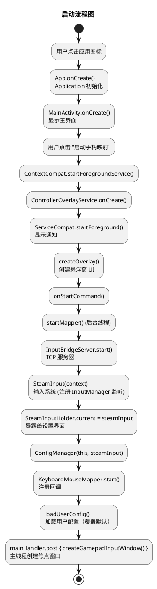

---

## 线程模型

应用涉及多个线程协同工作，关键操作必须放在正确的线程，否则会崩溃或行为异常。

### 线程总览

| 线程 | 创建者 | 职责 | 关键约束 |
|------|--------|------|---------|
| **主线程 (UI Thread)** | Android 系统 | UI 操作、Handler 回调、事件分发、按键映射处理 | 禁止网络操作 |
| **Mapper 后台线程** | `ControllerOverlayService.startMapper()` | TCP 服务器初始化、SteamInput 创建、ConfigManager 初始化 | 一次性任务 |
| **BridgeServer-Accept** | `InputBridgeServer.start()` | 接受客户端连接 | 阻塞在 `ServerSocket.accept()` |
| **BridgeServer-Dispatch** | `InputBridgeServer.start()` | 从消息队列取数据包发送给客户端 | 阻塞在 `queue.poll()` |
| **BridgeServer-Client-N** | `InputBridgeServer.acceptLoop()` | 监听单个客户端断开（每客户端一线程） | 阻塞在 `input.read()` |

### 线程交互图

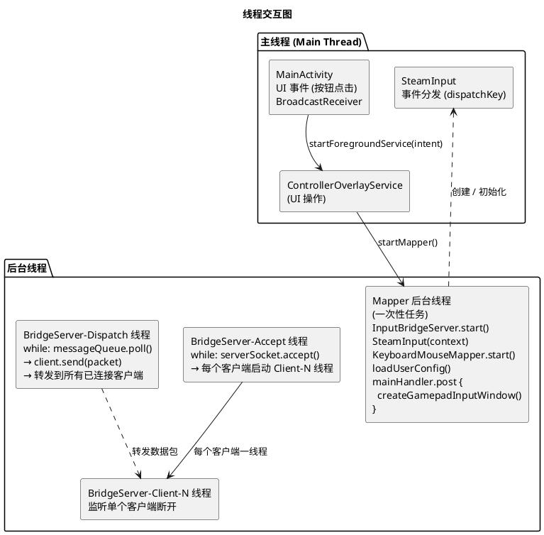

### 各线程详细说明

#### 1. 主线程 (UI Thread / Main Thread)

- **创建者**: Android 系统，在 `ActivityThread.main()` 中创建 `Looper`
- **职责**:
  - UI 操作（`WindowManager.addView`、`TextView.setText`、`Toast.show`）
  - Handler 回调（`mainHandler.post` / `postDelayed`）
  - 系统事件分发（`View.dispatchKeyEvent` / `dispatchGenericMotionEvent`）
  - 按键映射处理（`SteamInput.handleButtonEvent` → `KeyboardMouseMapper.handleMapping`）
  - `BroadcastReceiver.onReceive` 回调（客户端连接状态）
- **关键约束**: 禁止网络操作（`NetworkOnMainThreadException`），禁止长时间阻塞

#### 2. Mapper 后台线程

- **创建者**: `ControllerOverlayService.startMapper()` 中的 `Thread { ... }.start()`
- **职责**: 一次性初始化任务
  - `InputBridgeServer.start()` — TCP 服务器绑定端口（网络操作，禁止主线程）
  - `SteamInput(context)` — 创建输入控制器（注册 InputManager 监听）
  - `ConfigManager` 初始化
  - `KeyboardMouseMapper.start()` — 注册回调
  - `loadUserConfig()` — 加载内部配置文件
  - `mainHandler.post { createGamepadInputWindow() }` — 切回主线程创建焦点窗口
- **生命周期**: 任务完成后线程退出（非长驻）

#### 3. BridgeServer-Accept 线程

- **创建者**: `InputBridgeServer.start()` 内部 `Thread { acceptLoop() }.start()`
- **职责**: 阻塞调用 `ServerSocket.accept()` 等待客户端连接
- **行为**: 每接受一个客户端连接，启动一个新的 `BridgeServer-Client-N` 线程监听该客户端
- **关键约束**: `accept()` 是阻塞调用，必须在子线程

#### 4. BridgeServer-Dispatch 线程

- **创建者**: `InputBridgeServer.start()` 内部 `Thread { dispatchLoop() }.start()`
- **职责**: 从 `ConcurrentLinkedQueue<ByteArray>` 消息队列取数据包，发送给所有已连接客户端
- **行为**: 队列为空时 `Thread.sleep(1)` 避免忙等待
- **关键约束**: 网络发送在专用线程，避免阻塞主线程的输入回调

#### 5. BridgeServer-Client-N 线程

- **创建者**: `InputBridgeServer.acceptLoop()` 中为每个客户端启动
- **职责**: 监听单个客户端的断开（`input.read()` 返回 -1 表示断开）
- **行为**: 客户端断开时清理资源，触发 `onClientDisconnected` 回调
- **数量**: 每个已连接客户端一个线程

### 关键线程规则

#### 规则 1: 网络操作必须在子线程

```kotlin
// ❌ 错误: 在主线程执行会抛 NetworkOnMainThreadException
ServerSocket().bind(InetSocketAddress(port))

// ✅ 正确: 在子线程执行
Thread {
    ServerSocket().bind(InetSocketAddress(port))
}.start()
```

- **原因**: Android 禁止主线程执行网络 IO，防止阻塞 UI
- **位置**: [ControllerOverlayService.kt](app/src/main/java/com/steamlike/controller/service/ControllerOverlayService.kt) `startMapper()` 整体放在 `Thread { ... }.start()` 中

#### 规则 2: UI 操作必须在主线程

```kotlin
// ❌ 错误: 在子线程添加 View 会崩溃
windowManager.addView(gamepadInputView, params)

// ✅ 正确: 通过 Handler 切回主线程
mainHandler.post {
    windowManager.addView(gamepadInputView, params)
}
```

- **原因**: `WindowManager.addView()`、`TextView.setText()`、`Toast.show()` 等都必须在主线程
- **位置**: `ControllerOverlayService.startMapper()` 在子线程完成网络初始化后，通过 `mainHandler.post { createGamepadInputWindow() }` 切回主线程创建窗口

#### 规则 3: 输入事件在主线程分发

```kotlin
// GamepadInputView.dispatchKeyEvent 在主线程调用
// → KeyboardMouseMapper.onKeyEvent (主线程)
// → SteamInput.dispatchKeyEvent (主线程)
// → SteamInput.handleButtonEvent (主线程)
// → KeyboardMouseMapper.handleMapping (主线程)
// → BridgeInputInjector.sendKeyDown (主线程)
// → InputBridgeServer.messageQueue.add (主线程，非阻塞入队)
```

- **原因**: View 事件分发在主线程，整个按键映射链路同线程避免竞态
- **优势**: `KeyboardMouseMapper` 的 `pressedMainKeys`/`pressedSubKeys` 无需同步

#### 规则 4: 线程安全集合

```kotlin
// SteamInput.kt 使用并发安全集合
private val activeLayers = CopyOnWriteArrayList<OperationLayer>()
private val connectedControllers = ConcurrentHashMap<Int, ControllerDevice>()
private val heldButtons = CopyOnWriteArraySet<ControllerButton>()
```

- **原因**: `profile` 是 `@Volatile` 变量，可能被 LayerEditActivity 在主线程修改；输入事件也在主线程
- **ConcurrentHashMap**: 高并发读写的设备映射表
- **CopyOnWriteArrayList**: 读多写少的激活层列表（遍历时不会抛 ConcurrentModificationException）
- **CopyOnWriteArraySet**: 当前按住的按钮集合

#### 规则 5: TCP 服务器使用消息队列解耦

```kotlin
// InputBridgeServer.kt
private val messageQueue = ConcurrentLinkedQueue<ByteArray>()

// 调用方（主线程）入队
fun sendKeyEvent(vkCode: Int, isDown: Boolean) {
    val packet = ByteArray(PACKET_SIZE)
    // ... 填充 packet
    messageQueue.add(packet)  // 入队，不阻塞
}

// 分发线程（专用线程）出队并发送
private fun dispatchLoop() {
    while (isRunning.get()) {
        val packet = messageQueue.poll()
        if (packet != null) {
            for (client in clients) {
                client.send(packet)  // 实际网络发送
            }
        } else {
            Thread.sleep(1)  // 避免忙等待
        }
    }
}
```

- **优势**: 调用方（主线程的输入回调）不阻塞，网络发送在专用线程异步执行
- **背压控制**: 如果队列过长会消耗内存，但实际手柄事件频率有限（~60Hz），不会成为瓶颈

---

## 模块说明

应用按职责划分为 5 个核心模块 + 1 个服务模块 + 1 个入口模块。

### 模块依赖关系

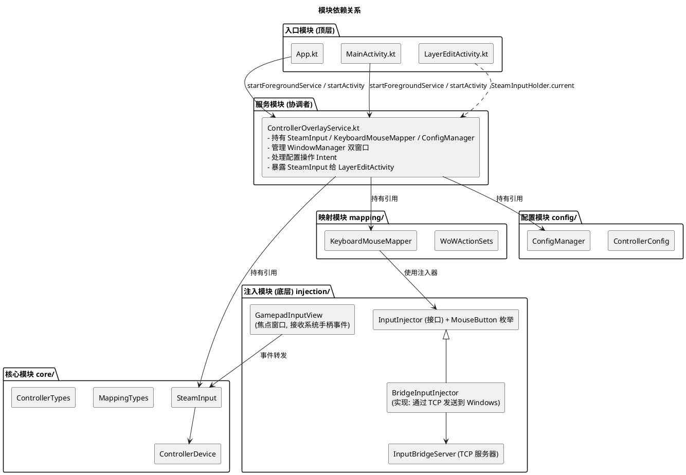

### 各模块详细说明

#### 1. 入口模块 (`com.steamlike.controller`)

| 文件 | 职责 |
|------|------|
| [App.kt](app/src/main/java/com/steamlike/controller/App.kt) | Application 入口，预留全局初始化 |
| [MainActivity.kt](app/src/main/java/com/steamlike/controller/MainActivity.kt) | 主界面，权限管理 + 配置 UI + 客户端状态监听 |
| [LayerEditActivity.kt](app/src/main/java/com/steamlike/controller/LayerEditActivity.kt) | 操作层设置界面，编辑按键映射/子命令/触发键 |

#### 2. 服务模块 (`service`)

| 文件 | 职责 |
|------|------|
| [ControllerOverlayService.kt](app/src/main/java/com/steamlike/controller/service/ControllerOverlayService.kt) | 前台服务，协调所有模块，管理双窗口，暴露 SteamInput 给 LayerEditActivity |

#### 3. 核心模块 (`core`)

| 文件 | 职责 |
|------|------|
| [SteamInput.kt](app/src/main/java/com/steamlike/controller/core/SteamInput.kt) | 主控制器，管理 ControllerProfile、激活层列表、设备监听、按键查询 |
| [MappingTypes.kt](app/src/main/java/com/steamlike/controller/core/MappingTypes.kt) | 数据结构定义（MappedAction/KeyMapping/OperationLayer/GlobalSettings/ControllerProfile） |
| [ControllerTypes.kt](app/src/main/java/com/steamlike/controller/core/ControllerTypes.kt) | 枚举定义（ControllerButton/ControllerStick/ControllerType）+ Vector2 |
| [ControllerDevice.kt](app/src/main/java/com/steamlike/controller/core/ControllerDevice.kt) | 设备信息 + ControllerInputMapper（键码映射工具） |

#### 4. 映射模块 (`mapping`)

| 文件 | 职责 |
|------|------|
| [WoWActionSets.kt](app/src/main/java/com/steamlike/controller/mapping/WoWActionSets.kt) | WoW 预设层名映射（LAYER_NAMES: Layer1-Layer10 → 中文名） |
| [KeyboardMouseMapper.kt](app/src/main/java/com/steamlike/controller/mapping/KeyboardMouseMapper.kt) | 手柄→键鼠映射器，子命令注入，层切换委托 |

#### 5. 配置模块 (`config`)

| 文件 | 职责 |
|------|------|
| [ControllerConfig.kt](app/src/main/java/com/steamlike/controller/config/ControllerConfig.kt) | JSON 序列化/反序列化（version=3） |
| [ConfigManager.kt](app/src/main/java/com/steamlike/controller/config/ConfigManager.kt) | 导出/导入逻辑 + 文件 IO（内部存储 + SAF） |

#### 6. 注入模块 (`injection`)

| 文件 | 职责 |
|------|------|
| [InputInjector.kt](app/src/main/java/com/steamlike/controller/injection/InputInjector.kt) | 注入器接口 + MouseButton 枚举 |
| [BridgeInputInjector.kt](app/src/main/java/com/steamlike/controller/injection/BridgeInputInjector.kt) | 桥接注入器实现，Android KeyCode → Windows VK Code |
| [InputBridgeServer.kt](app/src/main/java/com/steamlike/controller/injection/InputBridgeServer.kt) | TCP 服务器，端口 27015，8 字节定长包协议 |
| [GamepadInputView.kt](app/src/main/java/com/steamlike/controller/injection/GamepadInputView.kt) | 全屏透明焦点窗口，捕获系统 KeyEvent/MotionEvent |

---

## 类图 (PlantUML)

> 以下类图使用 [PlantUML](https://plantuml.com/) 语法描述核心类的结构与依赖关系，与源码一一对应。
> 渲染方法：安装 PlantUML 插件（VS Code / IDEA / Typora）或访问 [PlantUML 在线服务器](https://www.plantuml.com/plantuml) 粘贴 `@startuml` 与 `@enduml` 之间的内容。

### 1. 核心数据结构（[MappingTypes.kt](app/src/main/java/com/steamlike/controller/core/MappingTypes.kt) / [ControllerTypes.kt](app/src/main/java/com/steamlike/controller/core/ControllerTypes.kt)）

`ControllerProfile` 是完整配置（公共层 + 10 操作层 + 全局设置）；`KeyMapping` 由主动作 + 子命令组成；`MappedAction` 为密封类，枚举全部映射动作类型。

```plantuml
@startuml
title 核心数据结构
skinparam classAttributeIconSize 0
skinparam classFontSize 13
skinparam classAttributeFontSize 11

class ControllerProfile {
  + commonLayer : OperationLayer
  + layers : List<OperationLayer>
  + globalSettings : GlobalSettings
  + allLayers : List<OperationLayer>
  + findLayer(name) : OperationLayer?
  + findLayerByTrigger(button) : OperationLayer?
  + {static} MAX_LAYERS = 10
  + {static} createDefault() : ControllerProfile
}

class OperationLayer {
  + name : String
  + triggerButton : ControllerButton?
  + buttonMappings : MutableMap<ControllerButton, KeyMapping>
  + getMapping(button) : KeyMapping?
}

class KeyMapping {
  + action : MappedAction
  + subCommands : List<Int>
  + describe() : String
  + {static} MAX_SUB_COMMANDS = 3
  + {static} keyCodeToName(keyCode) : String
}

class GlobalSettings {
  + deadzone : Float
  + lookSensitivity : Float
  + cursorSpeed : Float
  + lookSmoothing : Float
  + lookAcceleration : Float
}

abstract class "MappedAction (sealed)" as MappedAction
class KeyboardKey { + keyCode : Int }
class MouseClick { + button : MouseButton }
class SwitchLayer { + layerName : String }
class MouseToggle { + button : MouseButton }
class MouseMove
class LookAround
class MouseScrollUp
class MouseScrollDown
class ToggleOverlay
class ToggleKeyboard
class ToggleCapture

enum ControllerButton {
  A, B, X, Y
  LEFT_SHOULDER, RIGHT_SHOULDER
  LEFT_TRIGGER_CLICK, RIGHT_TRIGGER_CLICK
  LEFT_STICK_CLICK, RIGHT_STICK_CLICK
  MENU, OPTIONS, GUIDE
  DPAD_UP, DPAD_DOWN, DPAD_LEFT, DPAD_RIGHT
  TOUCHPAD_CLICK
}

ControllerProfile *-- "1" OperationLayer : commonLayer
ControllerProfile *-- "0..10" OperationLayer : layers
ControllerProfile *-- "1" GlobalSettings
OperationLayer *-- "0..*" KeyMapping : buttonMappings
OperationLayer --> ControllerButton : triggerButton
KeyMapping *-- "1" MappedAction : action
MappedAction <|-- KeyboardKey
MappedAction <|-- MouseClick
MappedAction <|-- SwitchLayer
MappedAction <|-- MouseToggle
MappedAction <|-- MouseMove
MappedAction <|-- LookAround
MappedAction <|-- MouseScrollUp
MappedAction <|-- MouseScrollDown
MappedAction <|-- ToggleOverlay
MappedAction <|-- ToggleKeyboard
MappedAction <|-- ToggleCapture
@enduml
```

### 2. 输入系统核心（[SteamInput.kt](app/src/main/java/com/steamlike/controller/core/SteamInput.kt) / [KeyboardMouseMapper.kt](app/src/main/java/com/steamlike/controller/mapping/KeyboardMouseMapper.kt) / injection/）

`SteamInput` 负责设备监听、层激活与按键查询；`KeyboardMouseMapper` 负责注入回调（子命令、右摇杆 125Hz 发送循环）；`InputInjector` 接口由 `BridgeInputInjector` 实现（Android → TCP → Windows）。

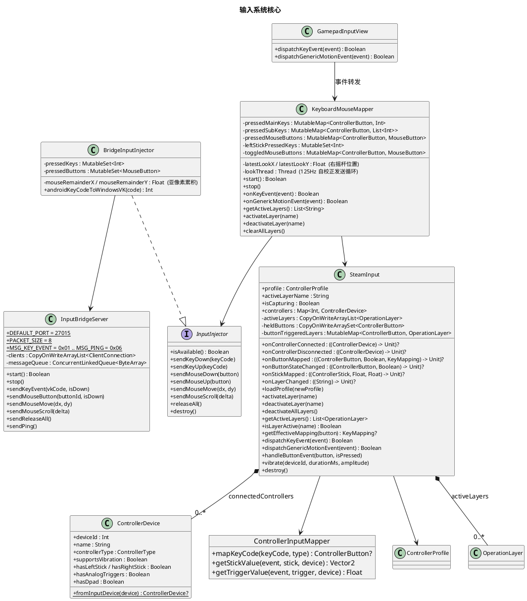

### 3. 配置与序列化（config/）

[ControllerConfig.kt](app/src/main/java/com/steamlike/controller/config/ControllerConfig.kt) 负责 version=3 JSON 序列化（兼容 version=2 迁移）；`ConfigManager` 负责文件 IO（内部存储 + SAF）；`AppConfig` / `AppConfigStore` 管理运行时设置。

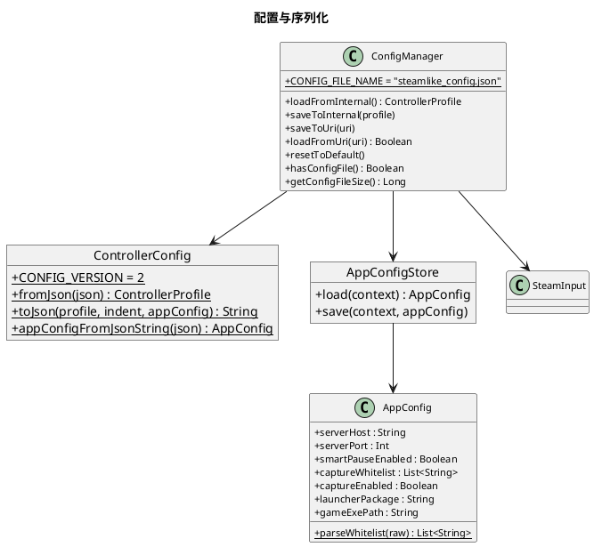

### 4. UI 与服务（service/ + 入口 Activity）

[ControllerOverlayService.kt](app/src/main/java/com/steamlike/controller/service/ControllerOverlayService.kt) 是前台服务与总协调者，持有所有核心模块并管理双窗口；`MainActivity` / `LayerEditActivity` / `HelpActivity` / `GamepadTestActivity` 为入口界面。

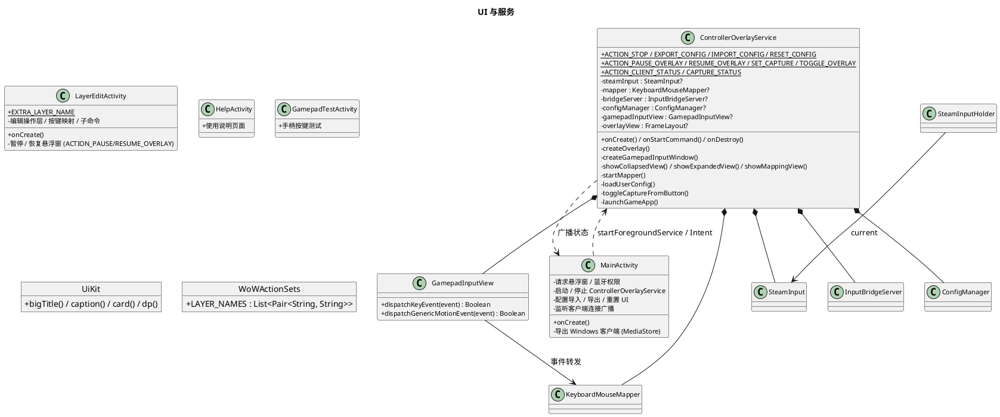

---

## 数据结构

所有核心数据结构定义在 [MappingTypes.kt](app/src/main/java/com/steamlike/controller/core/MappingTypes.kt) 中。

### 核心数据结构总览

```
ControllerProfile (完整配置)
  ├─ commonLayer: OperationLayer                  ← 公共层（始终激活）
  │    ├─ name: String                            ← 层名（"Common"）
  │    ├─ triggerButton: ControllerButton? = null ← 公共层无触发键
  │    └─ buttonMappings: MutableMap<ControllerButton, KeyMapping>
  │
  ├─ layers: List<OperationLayer>                 ← 操作层列表（最多10个）
  │    ├─ name: String                            ← 层名（"Layer1"-"Layer10"）
  │    ├─ triggerButton: ControllerButton?        ← 触发按键
  │    └─ buttonMappings: MutableMap<ControllerButton, KeyMapping>
  │
  └─ globalSettings: GlobalSettings               ← 全局摇杆设置
       ├─ deadzone: Float = 0.0f
       ├─ lookSensitivity: Float = 1.0f
       └─ cursorSpeed: Float = 1.0f

KeyMapping (按键映射)
  ├─ action: MappedAction                         ← 主动作
  └─ subCommands: List<Int>                       ← 子命令（最多3个KeyCode）

MappedAction (sealed class)
  ├─ KeyboardKey(keyCode: Int)
  ├─ MouseClick(button: MouseButton)
  ├─ SwitchLayer(layerName: String)
  ├─ MouseMove (data object)
  └─ LookAround (data object)
```

### MappedAction (sealed class)

映射动作类型，密封类限制子类在同一文件中定义，编译器保证 `when` 表达式覆盖所有分支。

```kotlin
sealed class MappedAction {
    data class KeyboardKey(val keyCode: Int) : MappedAction()        // 键盘按键
    data class MouseClick(val button: MouseButton) : MappedAction()  // 鼠标点击
    data class SwitchLayer(val layerName: String) : MappedAction()   // 切换操作层
    data object MouseMove : MappedAction()                           // 鼠标移动（摇杆专用）
    data object LookAround : MappedAction()                          // 视角控制（摇杆专用）
}
```

#### 各子类说明

| 子类 | 字段 | 用途 |
|------|------|------|
| `KeyboardKey` | `keyCode: Int` (Android `KeyEvent.KEYCODE_*`) | 映射为键盘按键，由 `BridgeInputInjector` 转换为 Windows VK Code 注入 |
| `MouseClick` | `button: MouseButton` (LEFT/RIGHT/MIDDLE) | 映射为鼠标按钮点击 |
| `SwitchLayer` | `layerName: String` (如 "Layer1") | 映射为操作层切换，按下激活目标层，松开停用 |
| `MouseMove` | (无) | 摇杆专用，映射为鼠标相对移动（×cursorSpeed） |
| `LookAround` | (无) | 摇杆专用，映射为视角控制（×lookSensitivity） |

#### Android 知识点: sealed class

Kotlin 密封类限制子类必须在同一文件中定义，编译器能保证 `when` 表达式覆盖所有分支。适用于有限状态的场景（如动作类型枚举）。与 `enum class` 不同，密封类每个子类可以有不同的字段，更灵活。

### KeyMapping

按键映射定义，包含主动作和最多 3 个子命令。

```kotlin
data class KeyMapping(
    val action: MappedAction,
    val subCommands: List<Int> = emptyList()
) {
    init {
        require(subCommands.size <= MAX_SUB_COMMANDS) {
            "子命令最多 $MAX_SUB_COMMANDS 个，当前 ${subCommands.size} 个"
        }
    }

    fun describe(): String  // 人类可读描述，如 "Alt+3"、"鼠标左键"

    companion object {
        const val MAX_SUB_COMMANDS = 3
        fun keyCodeToName(keyCode: Int): String  // KeyCode 转可读名称
    }
}
```

#### 字段说明

| 字段 | 类型 | 说明 |
|------|------|------|
| `action` | `MappedAction` | 主动作（键盘/鼠标/切换层/摇杆） |
| `subCommands` | `List<Int>` | 子命令 KeyCode 列表（最多3个，仅键盘按键） |

#### 子命令约束

- 子命令只支持键盘按键（`MappedAction.KeyboardKey` 的 keyCode），不支持鼠标/切换层
- 子命令最多 3 个（`MAX_SUB_COMMANDS = 3`），超过会抛出 `IllegalArgumentException`
- 主动作为 `SwitchLayer`、`MouseMove`、`LookAround` 时，子命令无效

#### keyCodeToName 方法

将 Android `KeyEvent.KEYCODE_*` 转换为人类可读名称，覆盖：
- 字母 A-Z
- 数字 0-9
- 功能键 F1-F12
- 修饰键 Shift/Ctrl/Alt
- 方向键 ↑↓←→
- 符号键 -=[];\,./` 等
- 锁定键 CapsLock/NumLock/ScrollLock
- 导航键 Insert/Home/PageUp/PageDown/End
- 数字键盘 Num0-Num9

### OperationLayer

操作层，包含按键映射表。公共层始终激活；操作层由公共层的 `SwitchLayer` 映射驱动激活（`triggerButton` 仅用于 UI 显示）。

```kotlin
data class OperationLayer(
    val name: String,
    val triggerButton: ControllerButton? = null,
    val buttonMappings: MutableMap<ControllerButton, KeyMapping> = mutableMapOf()
) {
    fun getMapping(button: ControllerButton): KeyMapping? = buttonMappings[button]
}
```

#### 字段说明

| 字段 | 类型 | 说明 |
|------|------|------|
| `name` | `String` | 层名（公共层="Common"，操作层="Layer1"-"Layer10"） |
| `triggerButton` | `ControllerButton?` | 触发按键（仅用于 UI 显示/说明，公共层为 null） |
| `buttonMappings` | `MutableMap<ControllerButton, KeyMapping>` | 按键映射表 |

#### 层类型

| 类型 | name | triggerButton | 激活方式 |
|------|------|---------------|---------|
| 公共层 | "Common" | null | 始终激活 |
| 操作层 1-10 | "Layer1"-"Layer10" | 显示用触发键 | 公共层 SwitchLayer 映射驱动：按下激活，松开停用 |

#### 触发按键机制

层切换由**公共层的 `MappedAction.SwitchLayer` 映射**驱动：按下绑定为 `SwitchLayer("LayerN")` 的按键时激活 LayerN，松开时停用（`buttonTriggeredLayers` 记录触发关系，确保激活层覆盖该按键映射时也能正确停用）。`OperationLayer.triggerButton` 字段仅用于 UI 显示/使用说明，不参与运行时激活；`findLayerByTrigger` 仅用于查询展示。

### GlobalSettings

全局摇杆设置，所有层统一配置。

```kotlin
data class GlobalSettings(
    val deadzone: Float = 0.15f,         // 死区（0.0~1.0），默认0.15
    val lookSensitivity: Float = 0.5f,   // 右摇杆视角灵敏度
    val cursorSpeed: Float = 1.0f,       // 光标移动速度
    val lookSmoothing: Float = 0.5f,     // 视角 EMA 平滑系数
    val lookAcceleration: Float = 1.5f   // 视角加速曲线指数
)
```

#### 参数说明

| 参数 | 默认值 | 范围 | 说明 |
|------|--------|------|------|
| `deadzone` | 0.15 | 0.0~1.0 | 摇杆死区，magnitude 小于此值归零。0=完全灵敏，0.2=中心20%区域忽略 |
| `lookSensitivity` | 0.5 | >0 | 右摇杆视角灵敏度。>1.0 更快，<1.0 更慢，实际移动=平滑后摇杆值×灵敏度×480px/秒×dt |
| `cursorSpeed` | 1.0 | >0 | 光标移动速度。>1.0 更快，<1.0 更慢 |
| `lookSmoothing` | 0.5 | 0.0~0.95 | 视角 EMA 平滑系数。0=关闭（最跟手但有抖动），越大越顺滑但延迟增加 |
| `lookAcceleration` | 1.5 | 0.5~3.0 | 视角加速曲线指数。1.0=线性，>1 轻推更慢、重推更快 |

> **注意**: 新架构中摇杆参数统一在 `GlobalSettings` 中配置，不再像旧架构那样按操作层覆盖。所有层共享同一组参数。

### ControllerProfile

控制器完整配置，包含公共层、操作层和全局设置。

```kotlin
data class ControllerProfile(
    val commonLayer: OperationLayer,
    val layers: List<OperationLayer>,
    val globalSettings: GlobalSettings = GlobalSettings()
) {
    val allLayers: List<OperationLayer>  // 公共层 + 操作层，用于UI显示
    fun findLayer(name: String): OperationLayer?  // 按名称查找层
    fun findLayerByTrigger(button: ControllerButton): OperationLayer?  // 按触发键查找层

    companion object {
        const val MAX_LAYERS = 10
        fun createDefault(): ControllerProfile  // 创建默认配置
    }
}
```

#### 属性与方法

| 成员 | 类型 | 说明 |
|------|------|------|
| `commonLayer` | `OperationLayer` | 公共层（始终激活） |
| `layers` | `List<OperationLayer>` | 操作层列表（最多10个） |
| `globalSettings` | `GlobalSettings` | 全局摇杆设置 |
| `allLayers` | `List<OperationLayer>` | 公共层 + 操作层，用于 UI 显示 |
| `findLayer(name)` | `OperationLayer?` | 按名称查找操作层 |
| `findLayerByTrigger(button)` | `OperationLayer?` | 按触发按键查找操作层（公共层返回 null） |

#### createDefault() 默认配置

`ControllerProfile.createDefault()` 创建默认配置，包含：

- **公共层 "Common"**: triggerButton=null，默认按键映射:
  - A → KeyboardKey(Space)
  - B → MouseClick(RIGHT)
  - X → MouseClick(LEFT)
  - Y → KeyboardKey(I)
  - MENU → KeyboardKey(Esc)
  - OPTIONS → KeyboardKey(M)
  - L3 → SwitchLayer("Layer9")
  - R3 → LookAround
  - LB → SwitchLayer("Layer5")
  - RB → SwitchLayer("Layer6")

- **10个操作层**: Layer1-Layer10，默认 buttonMappings 为空，触发键分配:
  | 层 | triggerButton |
  |----|---------------|
  | Layer1 | DPAD_UP |
  | Layer2 | DPAD_DOWN |
  | Layer3 | DPAD_LEFT |
  | Layer4 | DPAD_RIGHT |
  | Layer5 | LEFT_SHOULDER (LB) |
  | Layer6 | RIGHT_SHOULDER (RB) |
  | Layer7 | LEFT_STICK_CLICK (L3) |
  | Layer8 | RIGHT_STICK_CLICK (R3) |
  | Layer9 | LEFT_TRIGGER_CLICK (L2) |
  | Layer10 | RIGHT_TRIGGER_CLICK (R2) |

- **全局设置**: deadzone=0.0, lookSensitivity=1.0, cursorSpeed=1.0

### 枚举类型

#### `ControllerButton` - 标准手柄按键（跨平台统一）

```kotlin
enum class ControllerButton {
    A, B, X, Y,                                           // 面部按钮
    LEFT_SHOULDER, RIGHT_SHOULDER,                        // 肩键 LB/RB
    LEFT_TRIGGER_CLICK, RIGHT_TRIGGER_CLICK,              // 扳机点击 L2/R2
    LEFT_STICK_CLICK, RIGHT_STICK_CLICK,                   // 摇杆按下 L3/R3
    MENU, OPTIONS, GUIDE,                                 // 菜单/选项/Home键
    DPAD_UP, DPAD_DOWN, DPAD_LEFT, DPAD_RIGHT,            // 十字键
    TOUCHPAD_CLICK                                        // 触控板点击
}
```

- **跨平台**: 无论 Xbox/PS/Switch，都统一映射到此枚举
- **PS 手柄修正**: PS 的 ×/○ 与 Xbox 的 A/B 位置互换，由 `ControllerInputMapper` 自动修正

#### `ControllerStick` - 摇杆类型

```kotlin
enum class ControllerStick {
    LEFT_STICK,        // 左摇杆
    RIGHT_STICK,       // 右摇杆
    DPAD_AS_STICK      // 十字键作为摇杆（兼容无左摇杆的设备）
}
```

#### `ControllerType` - 手柄类型（用于按键修正）

通过 USB Vendor ID / Product ID 识别：

| 类型 | Vendor ID | Product ID |
|------|-----------|------------|
| XBOX_360 | 0x045E | 0x028E |
| XBOX_ONE | 0x045E | 0x02DD |
| XBOX_ELITE | 0x045E | 0x0B00 |
| PS3 | 0x054C | 0x0268 |
| PS4 | 0x054C | 0x05C4 |
| PS5_DUALSENSE | 0x054C | 0x0CE6 |
| SWITCH_PRO | 0x057E | 0x2009 |
| STEAM_CONTROLLER | 0x28DE | 0x1102 |
| STEAM_DECK | 0x28DE | 0x1205 |
| GENERIC | -1 | null |

#### `MouseButton` - 鼠标按钮

```kotlin
enum class MouseButton { LEFT, RIGHT, MIDDLE }
```

定义在 [InputInjector.kt](app/src/main/java/com/steamlike/controller/injection/InputInjector.kt) 中。

### 辅助数据结构

#### `Vector2` - 2D 向量

```kotlin
data class Vector2(
    val x: Float = 0f,                 // X 轴（右为正）
    val y: Float = 0f                  // Y 轴（下为正，与 Android 屏幕坐标一致）
) {
    val magnitude: Float               // 向量长度（0.0~1.0）
    fun normalized(): Vector2          // 归一化
    fun withDeadzone(deadzone: Float): Vector2  // 应用死区
    companion object { val ZERO = Vector2(0f, 0f) }
}
```

#### `ControllerDevice` - 手柄设备信息

```kotlin
data class ControllerDevice(
    val deviceId: Int,                 // Android 设备 ID
    val name: String,                  // 设备名称
    val controllerType: ControllerType,// 手柄类型
    val inputDevice: InputDevice,      // Android InputDevice
    val supportsVibration: Boolean,    // 是否支持震动
    val hasLeftStick: Boolean,         // 是否有左摇杆
    val hasRightStick: Boolean,        // 是否有右摇杆
    val hasAnalogTriggers: Boolean,    // 是否有模拟扳机
    val hasDpad: Boolean               // 是否有十字键
)
```

### 设计模式说明

#### 1. **纯数据类与回调分离**

- **数据类**（`ControllerProfile`、`KeyMapping`、`MappedAction`）只存储数据，可序列化
- **回调**（`onButtonMapped`、`onStickMapped`、`onLayerChanged`）在 `SteamInput` 中定义，不可序列化
- 因此配置文件可完整描述按键映射，回调在代码中绑定

#### 2. **密封类（sealed class）多态**

`MappedAction` 使用密封类表示五种动作类型，编译器会检查 `when` 表达式的完整性，避免遗漏新增类型。

#### 3. **回退模式（Fallback Pattern）**

按键查询采用回退机制：
- 遍历激活操作层查找 `buttonMappings[button]`
- 未找到则回退到公共层 `commonLayer.buttonMappings[button]`
- 公共层始终激活，提供默认绑定

#### 4. **接口抽象（多态注入）**

`InputInjector` 接口允许不同的注入实现：
- 当前实现: `BridgeInputInjector`（通过 TCP 桥接到 Windows）
- 可扩展: 未来可添加 `LocalInputInjector`（直接注入 Android 系统）

#### 5. **不可变数据 + copy 重建**

`OperationLayer`、`ControllerProfile` 等使用 `data class`，关键字段为 `val`（不可变）。修改时使用 `copy()` 创建新实例并重建 profile，保证数据一致性。

---

## Android API 说明

本项目使用的关键 Android API 说明，便于理解代码和扩展功能。

### 1. InputManager - 输入设备管理

`InputManager` 是 Android 系统服务，管理所有输入设备。

```kotlin
// 获取 InputManager 系统服务
val inputManager = context.getSystemService(Context.INPUT_SERVICE) as InputManager

// 获取所有设备ID
val deviceIds = InputDevice.getDeviceIds()

// 获取设备详情
val device = InputDevice.getDevice(deviceId)

// 判断是否为手柄设备
if (device.supportsSource(InputDevice.SOURCE_GAMEPAD) ||
    device.supportsSource(InputDevice.SOURCE_JOYSTICK)) {
    // 是手柄
}

// 注册设备插拔监听器（必须在主线程注册）
inputManager.registerInputDeviceListener(listener, mainHandler)
```

**本项目使用位置**: [SteamInput.kt](app/src/main/java/com/steamlike/controller/core/SteamInput.kt)
- `registerInputDeviceListener` 监听手柄插入/拔出
- `InputDevice.getDeviceIds()` 扫描已连接设备
- `device.supportsSource(SOURCE_GAMEPAD)` 识别手柄

**回调方法**:
- `onInputDeviceAdded(deviceId)`: 设备插入（如连接蓝牙手柄）
- `onInputDeviceRemoved(deviceId)`: 设备拔出
- `onInputDeviceChanged(deviceId)`: 设备配置变化

### 2. Handler & Looper - 线程通信

`Handler` 绑定到 `Looper`，用于在线程间发送消息和执行代码。

```kotlin
// 获取主线程 Handler
val mainHandler = Handler(Looper.getMainLooper())

// 在主线程执行代码
mainHandler.post {
    // UI 操作
}

// 延迟执行
mainHandler.postDelayed(runnable, 16)  // 16ms ≈ 60fps
```

**本项目使用位置**:
- `SteamInput.mainHandler`: 注册 `InputDeviceListener`、事件分发
- `ControllerOverlayService.mainHandler`: 从后台线程切回主线程创建焦点窗口
- `InputBridgeServer`: 跨线程更新 UI 状态

**Android 知识点**: 主线程 Looper 由 Android 系统在 `ActivityThread.main()` 中创建，应用启动后即可使用 `Looper.getMainLooper()` 获取。

### 3. WindowManager - 窗口管理

`WindowManager` 管理窗口的添加、更新、移除，用于实现悬浮窗。

```kotlin
val windowManager = context.getSystemService(WINDOW_SERVICE) as WindowManager

// 创建悬浮窗参数
val params = WindowManager.LayoutParams(
    WindowManager.LayoutParams.WRAP_CONTENT,
    WindowManager.LayoutParams.WRAP_CONTENT,
    if (Build.VERSION.SDK_INT >= Build.VERSION_CODES.O)
        WindowManager.LayoutParams.TYPE_APPLICATION_OVERLAY  // Android 8.0+
    else
        @Suppress("DEPRECATION")
        WindowManager.LayoutParams.TYPE_PHONE,  // Android 8.0 以下
    WindowManager.LayoutParams.FLAG_NOT_FOCUSABLE or
        WindowManager.LayoutParams.FLAG_LAYOUT_IN_SCREEN,
    PixelFormat.TRANSLUCENT
)

// 添加窗口
windowManager.addView(view, params)

// 更新窗口位置
windowManager.updateViewLayout(view, params)

// 移除窗口
windowManager.removeView(view)
```

**本项目使用位置**: [ControllerOverlayService.kt](app/src/main/java/com/steamlike/controller/service/ControllerOverlayService.kt)
- 双窗口架构: `GamepadInputView`（全屏透明焦点窗口）+ 悬浮 UI 面板
- `FLAG_NOT_TOUCHABLE`: 焦点窗口触摸穿透到下层 Winlator
- `TYPE_APPLICATION_OVERLAY`: 悬浮窗类型（需 `SYSTEM_ALERT_WINDOW` 权限）

### 4. Service - 前台服务

`Service` 是 Android 四大组件之一，用于在后台长期运行。前台服务显示通知栏，降低被系统杀死的概率。

```kotlin
class ControllerOverlayService : Service() {
    override fun onCreate() {
        super.onCreate()
        // Android 14+ 需要指定前台服务类型
        ServiceCompat.startForeground(
            this,
            NOTIFICATION_ID,
            createNotification("运行中..."),
            ServiceInfo.FOREGROUND_SERVICE_TYPE_SPECIAL_USE
        )
    }

    override fun onStartCommand(intent: Intent?, flags: Int, startId: Int): Int {
        // 处理 Intent action
        when (intent?.action) {
            ACTION_STOP -> stopSelf()
            ACTION_EXPORT_CONFIG -> handleExportConfig(uri)
            // ...
        }
        return START_STICKY  // 服务被杀后自动重启
    }

    override fun onBind(intent: Intent?): IBinder? = null  // 不支持绑定
}
```

**本项目使用位置**: [ControllerOverlayService.kt](app/src/main/java/com/steamlike/controller/service/ControllerOverlayService.kt)
- 前台服务类型: `FOREGROUND_SERVICE_TYPE_SPECIAL_USE`（Android 14+ 要求）
- 通知栏: 创建 `NotificationChannel` + `NotificationCompat.Builder`
- Intent action 通信: 接收 MainActivity 的配置操作指令

**启动方式**:
```kotlin
ContextCompat.startForegroundService(context, intent)
```

### 5. BroadcastReceiver - 广播接收器

`BroadcastReceiver` 用于接收系统或应用内的广播。

```kotlin
// 注册广播接收器（Android 14+ 需指定 RECEIVER_EXPORTED/RECEIVER_NOT_EXPORTED）
val receiver = object : BroadcastReceiver() {
    override fun onReceive(context: Context?, intent: Intent?) {
        when (intent?.action) {
            ACTION_CLIENT_STATUS -> {
                val statusText = intent.getStringExtra(EXTRA_STATUS_TEXT)
                val connected = intent.getBooleanExtra(EXTRA_CONNECTED, false)
                // 更新 UI
            }
        }
    }
}

ContextCompat.registerReceiver(
    this, receiver,
    IntentFilter(ACTION_CLIENT_STATUS),
    ContextCompat.RECEIVER_NOT_EXPORTED  // 仅应用内接收
)

// 注销
unregisterReceiver(receiver)
```

**本项目使用位置**: [MainActivity.kt](app/src/main/java/com/steamlike/controller/MainActivity.kt)
- `clientStatusReceiver`: 接收 ControllerOverlayService 广播的客户端连接状态
- `RECEIVER_NOT_EXPORTED`: 仅应用内接收（Android 14+ 强制要求指定）

**发送广播**:
```kotlin
val intent = Intent(ACTION_CLIENT_STATUS).apply {
    setPackage(packageName)  // 限定接收方
    putExtra(EXTRA_STATUS_TEXT, statusText)
    putExtra(EXTRA_CONNECTED, connected)
}
sendBroadcast(intent)
```

### 6. KeyEvent & MotionEvent - 输入事件

```kotlin
// KeyEvent 表示按钮事件
override fun dispatchKeyEvent(event: KeyEvent): Boolean {
    val action = event.action  // ACTION_DOWN / ACTION_UP
    val keyCode = event.keyCode  // KEYCODE_BUTTON_A 等
    val deviceId = event.deviceId
    val repeatCount = event.repeatCount  // 长按重复次数
    val isGamepad = event.isFromSource(InputDevice.SOURCE_GAMEPAD)
    return true
}

// MotionEvent 表示摇杆/扳机事件
override fun dispatchGenericMotionEvent(event: MotionEvent): Boolean {
    val x = event.getAxisValue(MotionEvent.AXIS_X)  // 左摇杆X
    val y = event.getAxisValue(MotionEvent.AXIS_Y)  // 左摇杆Y
    val z = event.getAxisValue(MotionEvent.AXIS_Z)  // 右摇杆X
    val rz = event.getAxisValue(MotionEvent.AXIS_RZ)  // 右摇杆Y
    val lt = event.getAxisValue(MotionEvent.AXIS_LTRIGGER)  // 左扳机
    val rt = event.getAxisValue(MotionEvent.AXIS_RTRIGGER)  // 右扳机
    return true
}
```

**本项目使用位置**: [GamepadInputView.kt](app/src/main/java/com/steamlike/controller/injection/GamepadInputView.kt)
- 重写 `dispatchKeyEvent` / `dispatchGenericMotionEvent` 捕获手柄事件
- 转发到 `KeyboardMouseMapper` → `SteamInput`

### 7. Storage Access Framework (SAF) - 文件选择

```kotlin
// 注册文件选择器（AndroidX Activity Result API）
private val createDocumentLauncher = registerForActivityResult(
    ActivityResultContracts.CreateDocument("application/json")
) { uri: Uri? ->
    if (uri != null) {
        // 用户选择了保存位置，uri 是 content:// URI
    }
}

private val openDocumentLauncher = registerForActivityResult(
    ActivityResultContracts.OpenDocument()
) { uri: Uri? ->
    if (uri != null) {
        // 用户选择了文件
    }
}

// 启动选择器
createDocumentLauncher.launch("steamlike_config.json")
openDocumentLauncher.launch(arrayOf("application/json", "text/plain", "*/*"))

// 通过 ContentResolver 读写
context.contentResolver.openOutputStream(uri)?.use { stream ->
    stream.write(json.toByteArray())
}
context.contentResolver.openInputStream(uri)?.use { stream ->
    val json = stream.bufferedReader().readText()
}
```

**本项目使用位置**: [MainActivity.kt](app/src/main/java/com/steamlike/controller/MainActivity.kt)
- `createDocumentLauncher`: 导出配置时选择保存位置
- `openDocumentLauncher`: 导入配置时选择文件
- 替代已废弃的 `startActivityForResult`

### 8. MediaStore - 公共目录写入

```kotlin
// Android 10+ 通过 MediaStore.Downloads 写入公共目录
val values = ContentValues().apply {
    put(MediaStore.MediaColumns.DISPLAY_NAME, "inputbridge_client.exe")
    put(MediaStore.MediaColumns.MIME_TYPE, "application/octet-stream")
    put(MediaStore.MediaColumns.RELATIVE_PATH, "${Environment.DIRECTORY_DOWNLOADS}/AControler")
}
val uri = contentResolver.insert(MediaStore.Downloads.EXTERNAL_CONTENT_URI, values)
contentResolver.openOutputStream(uri)?.use { stream ->
    stream.write(bytes)
}
```

**本项目使用位置**: [MainActivity.kt](app/src/main/java/com/steamlike/controller/MainActivity.kt)
- `exportViaMediaStore`: Android 10+ 导出 Windows 客户端文件到 Download/AControler
- `exportViaLegacyFile`: Android 9 及以下直接写入外部存储

### 9. VibrationEffect - 震动反馈

```kotlin
// API 26+ 使用 VibrationEffect
if (Build.VERSION.SDK_INT >= Build.VERSION_CODES.O) {
    vibrator.vibrate(VibrationEffect.createOneShot(durationMs, amplitude))
} else {
    @Suppress("DEPRECATION")
    vibrator.vibrate(durationMs)
}
```

**本项目使用位置**: [SteamInput.kt](app/src/main/java/com/steamlike/controller/core/SteamInput.kt) `vibrate()` 方法

---

## 测试目录

### 测试覆盖

应用在 `app/src/test/` 目录下提供单元测试，使用 JUnit 4 + 纯 JVM 运行（无需 Android 设备/模拟器）。

### 测试文件清单

| 文件 | 测试内容 | 状态 |
|------|---------|------|
| [Vector2Test.kt](app/src/test/java/com/steamlike/controller/core/Vector2Test.kt) | 2D 向量运算（magnitude/normalized/withDeadzone） | 保留 |
| [ControllerTypesTest.kt](app/src/test/java/com/steamlike/controller/core/ControllerTypesTest.kt) | 枚举解析（ControllerButton/ControllerType.fromVendorProduct） | 保留 |

### 旧测试（已删除）

以下测试针对旧架构（ActionSet/ActionSetLayer/ChordBinding）编写，重构后已删除：

- `ChordBindingTest.kt` - 旧组合键匹配测试（被 KeyMapping 子命令机制取代）
- `ActionSetTest.kt` - 旧动作集合容器测试（被 ControllerProfile 取代）
- `ActionSetLayerTest.kt` - 旧操作层覆盖测试（被 OperationLayer 取代）
- `SteamInputTest.kt` - 旧绑定查找逻辑测试（待新架构稳定后重写）
- `ControllerConfigTest.kt`（旧版） - 旧 version=1 配置测试（被 version=2 取代）

### 新测试

- `KeyMappingTest.kt` - 测试 `KeyMapping.describe()`、`keyCodeToName()`、子命令约束（MAX_SUB_COMMANDS）
- `OperationLayerTest.kt` - 测试 `OperationLayer.getMapping()`、`ControllerProfile.findLayer()`/`findLayerByTrigger()`/`createDefault()`
- `ControllerConfigTest.kt`（新版） - 测试 version=3 JSON 序列化/反序列化往返、动作类型解析、子命令解析
- `ProtocolConstantsTest.kt` - 锁定 TCP 协议常量取值，防止与 Rust 端（[docs/protocol.md](docs/protocol.md)）漂移

### 测试策略

#### 1. 纯 JVM 测试（无 Android 依赖）

新架构的 `MappingTypes.kt` 中所有数据类都是纯 Kotlin 类（`MappedAction`、`KeyMapping`、`OperationLayer`、`GlobalSettings`、`ControllerProfile`），不依赖 Android `Context`，可直接在纯 JVM 环境测试。

`ControllerConfig.kt` 使用 `org.json`（Android 内置），测试时使用标准 Java 实现 `org.json:json:20240303` 替代。

#### 2. 配置文件往返测试

```kotlin
@Test
fun `配置往返测试`() {
    val original = ControllerProfile.createDefault()
    val json = ControllerConfig.toJson(original, 2)
    val parsed = ControllerConfig.fromJson(json)
    assertEquals(original.commonLayer.name, parsed.commonLayer.name)
    assertEquals(original.layers.size, parsed.layers.size)
    assertEquals(original.globalSettings.deadzone, parsed.globalSettings.deadzone)
}
```

### 运行测试

```bash
# 运行所有单元测试
./gradlew test

# 运行特定测试类
./gradlew test --tests "com.steamlike.controller.core.Vector2Test"
```

### 测试依赖

```kotlin
// app/build.gradle.kts
dependencies {
    // ... 实现依赖 ...

    // 单元测试依赖
    testImplementation("junit:junit:4.13.2")
    testImplementation("org.json:json:20240303")  // JSON 解析（替代 Android org.json）
}
```

> **说明**: 测试使用 `org.json:json:20240303`（标准 Java 实现）替代 Android 内置的 `org.json`，因为单元测试运行在纯 JVM 环境，无法访问 Android API。

---

## 技术原理

### 1. 焦点窗口捕获手柄事件（无 Root/无 Shizuku）

Android 系统会将手柄的 `KeyEvent` / `MotionEvent` 分发给**当前持有焦点的窗口**。本应用创建一个**全屏透明、不可触摸**的悬浮窗（`TYPE_APPLICATION_OVERLAY`），并使其获得焦点，从而直接接收系统分发的手柄事件：

```
手柄硬件 → Android InputManager → 焦点窗口
                                      ↓
                          GamepadInputView (全屏透明, FLAG_NOT_TOUCHABLE)
                                      ↓
                          dispatchKeyEvent() / dispatchGenericMotionEvent()
                                      ↓
                          转发到 KeyboardMouseMapper → SteamInput
```

关键点：
- `FLAG_NOT_TOUCHABLE`: 窗口不拦截触摸事件，触摸会穿透到下层应用（不影响 Winlator 操作）
- `FLAG_LAYOUT_IN_SCREEN | FLAG_LAYOUT_NO_LIMITS`: 全屏覆盖
- `isFocusable = true; isFocusableInTouchMode = true`: 可获取焦点
- 通过 `requestFocus()` 主动获取焦点；失去焦点时（如切换应用）需重新请求

### 2. 双窗口架构

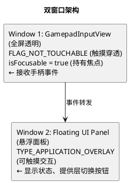

### 3. 摇杆死区处理

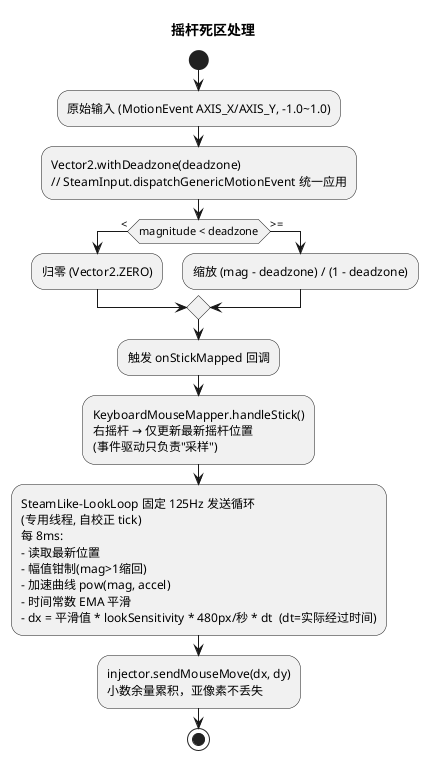

### 4. 操作层激活/停用

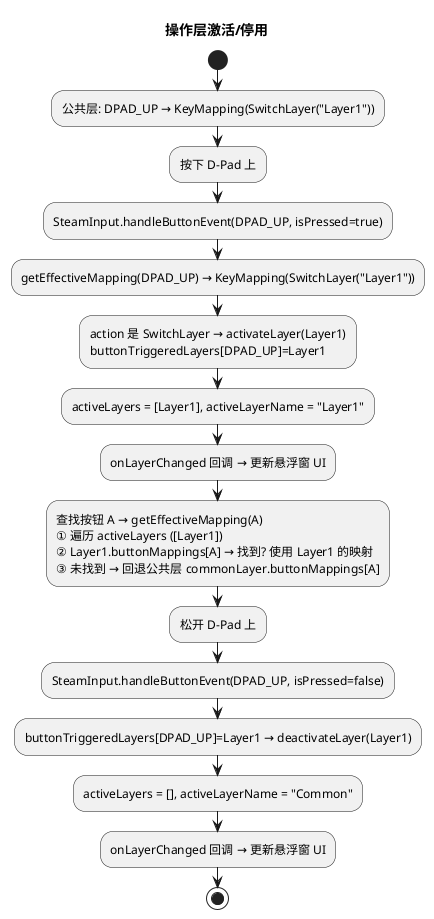

### 5. 子命令注入（Sub-Command）

```
按下按钮 X (KeyMapping(KeyboardKey(Alt), subCommands=[KEYCODE_3])):
  SteamInput 找到 mapping → onButtonMapped 回调
     ↓
KeyboardMouseMapper.handleMapping(X, isPressed=true, mapping)
     ↓ handleKeyboardKey(X, true, mainKeyCode=Alt, subCommands=[3])
     ↓ 1. injector.sendKeyDown(Alt)    ← 按下主键
     ↓ 2. injector.sendKeyDown(3)      ← 按下子命令键
     ↓ 记录: pressedMainKeys[X]=Alt, pressedSubKeys[X]=[3]

松开按钮 X:
  KeyboardMouseMapper.handleMapping(X, isPressed=false, mapping)
     ↓ handleKeyboardKey(X, false, mainKeyCode=Alt, subCommands=[3])
     ↓ 1. pressedSubKeys[X].reversed() → [3]
     ↓    injector.sendKeyUp(3)        ← 逆序松开子命令键
     ↓ 2. injector.sendKeyUp(Alt)      ← 最后松开主键
     ↓ 清理: pressedMainKeys.remove(X), pressedSubKeys.remove(X)

最终输出: Alt+3 组合键
```

### 6. SwitchLayer 动作处理

```
按下 LB (公共层 LB → SwitchLayer("Layer5")):
  SteamInput.handleButtonEvent(LEFT_SHOULDER, isPressed=true)
     ↓ getEffectiveMapping(LB) → KeyMapping(SwitchLayer("Layer5"))
     ↓ action 是 SwitchLayer
     ↓ profile.findLayer("Layer5") → Layer5
     ↓ activateLayer(Layer5) + buttonTriggeredLayers[LB]=Layer5
     ↓ return（不注入键鼠）

松开 LB:
  SteamInput.handleButtonEvent(LEFT_SHOULDER, isPressed=false)
     ↓ buttonTriggeredLayers[LB] = Layer5 → deactivateLayer(Layer5)
     ↓ activeLayers = [], activeLayerName = "Common"
```

---

## 通信协议

### TCP 协议概述

| 属性 | 值 |
|------|-----|
| 传输层 | TCP |
| 服务器 | Android APK (端口 27015) |
| 客户端 | Windows inputbridge_client.exe |
| 数据格式 | 8字节定长包 |
| 字节序 | 小端 (Little-Endian) |

### 消息类型

每个数据包固定8字节，第1字节为消息类型：

| 类型 | 值 | 格式 |
|------|-----|------|
| 键盘事件 | 0x01 | `[0x01][vkCode:u16][isDown:u8][保留:4B]` |
| 鼠标移动 | 0x02 | `[0x02][dx:i16][dy:i16][保留:3B]` |
| 鼠标按钮 | 0x03 | `[0x03][button:u8][isDown:u8][保留:5B]` |
| 鼠标滚轮 | 0x04 | `[0x04][delta:i16][保留:5B]` |
| 释放所有 | 0x05 | `[0x05][保留:7B]` |
| 心跳Ping | 0x06 | `[0x06][保留:7B]` |

### 字段说明

| 字段 | 类型 | 说明 |
|------|------|------|
| vkCode | uint16 | Windows虚拟键码 (如 VK_SPACE=0x20) |
| isDown | uint8 | 0=释放, 1=按下 |
| dx/dy | int16 | 鼠标相对位移 |
| button | uint8 | 0=左键, 1=右键, 2=中键 |
| delta | int16 | 滚轮增量 |

### 示例数据包

```
按下空格键:  01 20 00 01 00 00 00 00
释放空格键:  01 20 00 00 00 00 00 00
鼠标右移10px: 02 0A 00 00 00 00 00 00
左键按下:    03 00 01 00 00 00 00 00
释放所有:    05 00 00 00 00 00 00 00
```

---

## 依赖说明

| 依赖 | 版本 | 用途 |
|------|------|------|
| AndroidX Core KTX | 1.12.0 | AndroidX核心扩展 |
| AndroidX AppCompat | 1.6.1 | 向后兼容支持 |
| Material Components | 1.11.0 | Material Design组件 |
| ConstraintLayout | 2.1.4 | 布局 |
| JUnit | 4.13.2 | 单元测试 |
| org.json | 20240303 | 测试用 JSON 解析（替代 Android org.json） |

> **无外部特权依赖**：本应用不依赖 Shizuku、HiddenApiBypass、Root 等任何特权框架，仅使用 Android 公开 API + 标准AndroidX库。

### 权限说明

| 权限 | 用途 |
|------|------|
| `SYSTEM_ALERT_WINDOW` | 显示悬浮窗 + 全屏透明焦点窗口 |
| `FOREGROUND_SERVICE` | 前台服务(保持映射运行) |
| `FOREGROUND_SERVICE_SPECIAL_USE` (Android 14+) | 前台服务类型声明 |
| `INTERNET` | TCP 桥接服务器（localhost 通信） |
| `WRITE_EXTERNAL_STORAGE` (maxSdkVersion=29) | 导出 exe 到 Download 目录（Android 10 及以下） |
| `READ_EXTERNAL_STORAGE` (maxSdkVersion=32) | 读取外部存储（Android 12 及以下） |
| （可选）`POST_NOTIFICATIONS` (Android 13+) | 前台服务通知 |

---

## 常见问题

### Q: 手柄按键完全无响应

**A**: 焦点窗口可能失去了焦点。请：
1. 点击屏幕任意位置（使全屏透明焦点窗口重新获取焦点）
2. 确认 Android 端悬浮窗显示"客户端已连接"
3. 确认 Windows 端显示"已连接到Android服务器"
4. 确认手柄已被 Android 系统识别（设置 → 蓝牙/设备）
5. 若仍无效，尝试停止并重新启动"手柄映射"服务

### Q: 为什么需要点击屏幕才能用手柄？

**A**: Android 系统只将手柄事件分发给**持有焦点的窗口**。当切换应用（如从 SteamLike 切到 Winlator）时，焦点会转移到 Winlator，此时本应用的 `GamepadInputView` 失去焦点。
解决方式：触摸事件穿透设计（`FLAG_NOT_TOUCHABLE`）让点击落到 Winlator 的同时，本应用的透明窗口也能借机重新获得焦点（具体取决于系统焦点策略）。

### Q: 悬浮窗在的时候所有应用的右滑返回失效？

**A**: 这是 Android 13+ 预测式返回（Predictive Back）的系统级行为：可焦点悬浮窗（收手柄事件必须 focusable）是最上层的可返回窗口，会吃掉系统右滑返回手势，下层应用收不到。应用内无法让返回穿透焦点窗口。

已实现**智能暂停**解决（默认开启）：
1. 打开 App → **智能暂停** 区块 → 点击"授权使用情况访问"并在系统设置中开启（一次性）
2. 白名单默认含 `com.winlator`、`com.winlator.hub`（Winlator 官方/商店分支，按需增删包名，逗号分隔）
3. 生效逻辑：**白名单应用在前台 → 保持手柄捕获；切到其他应用 → 自动移除焦点窗口，右滑返回恢复正常；切回游戏 → 自动恢复捕获**

注意：
- 未授权"使用情况访问"时自动退化为手动模式（悬浮窗"暂停/恢复捕获"按钮，始终可用）
- App 内"手柄捕获"开关与悬浮窗按钮**双向同步**（任意一端暂停/恢复，另一端实时更新）
- **手动暂停会真正移除焦点窗口**：右滑返回立即恢复正常；但此时手柄按键不再到达手机，**"切换捕获"手柄键无法恢复捕获**，需再用悬浮窗"恢复捕获"按钮或 App 内"手柄捕获"开关恢复
- 悬浮窗"主页"按钮可一键回到手机桌面
- 若切到 Winlator 后手柄失效，先在 App 里确认你的 Winlator 包名在白名单中（常见变体：`com.winlator`、`com.winlator.hub`、`com.winlator.plus`）
- Winlator 内部界面（如容器列表）也在白名单内，右滑返回同样被捕获窗口接管；进入游戏全屏后无影响

### Q: 悬浮窗显示"等待Windows客户端连接"

**A**: 这是正常状态，表示Android端TCP服务器已启动，等待Winlator内的 `inputbridge_client.exe` 连接。请：
1. 确认已编译 `inputbridge_client.exe`（`./gradlew assembleDebug` 会自动调用 cargo 编译，或在 `windows/rust_client` 下执行 `cargo build --release`）
2. 将exe复制到Winlator的C盘
3. 在Winlator中运行 `inputbridge_client.exe`
4. 连接成功后悬浮窗会显示"客户端已连接"

### Q: inputbridge_client.exe 显示"连接失败"

**A**: 可能原因：
1. Android端未启动服务（先在Android端点击"启动手柄映射"）
2. 端口被占用（检查27015端口）
3. Winlator网络隔离（尝试指定Android设备IP: `inputbridge_client.exe 192.168.1.100`）

### Q: 按键卡住不释放

**A**: 
- 松开按键时按"按下时记录的状态"精确释放（与当前层映射无关），长按右键时切换操作层不会导致右键卡死
- Windows客户端断开时会自动释放所有按键
- 如果仍有问题（比如升级前就已卡住），关闭Windows客户端再重新打开，或按两下对应按键解除 toggle 锁存

### Q: 右摇杆/按右键转镜头一卡一卡？

**A**: 右摇杆采用业界标准做法：**固定 125Hz 自校正发送循环**（Steam Input/DS4Windows 同款思路）——
手柄事件回调只更新摇杆位置，由专用线程每 8ms 读取位置、按实际间隔积分位移并发送。
鼠标包时间分布均匀，不随 Android 事件到达抖动、主线程负载变化，最大程度还原真实鼠标的高频均匀位移。

配套优化：
- **TCP_NODELAY**：手柄事件是大量 8 字节小包，已禁用 Nagle，消除小包等待 ACK 的 ~40ms 周期延迟
- **时间常数 EMA 平滑**：与发送频率解耦，摇杆回中时平滑值立即收敛，无拖尾抖动
- **亚像素余量累积**：<1px 的位移不会丢弃，累计满 1px 补发

如果仍感觉卡顿，依次排查：
- **Winlator/Wine 鼠标设置**：确认使用相对移动模式（Raw Input），关闭系统指针加速；若光标会"撞到屏幕边缘停住"，说明 Wine 把相对移动当成了光标移动，需在 Winlator 中启用游戏的 raw input 支持
- **WoW 游戏内**："鼠标灵敏度"决定转镜总量，建议游戏内调高、程序内灵敏度调低，配合加速曲线手感最顺（业界惯例：游戏内管总量，程序内管曲线）
- **转镜头时避免光标悬停 UI**：WoW 光标悬停会持续刷新 tooltip 拖累帧率，按住 B（右键）转镜头时尽量把光标甩离 UI 区域
- **降低"平滑系数"**（0.3 更跟手）或**调高"加速曲线指数"**（轻推更稳）
- **帧率**：乌龟服在 Box64 模拟下帧率不稳会直接表现为视角卡顿，可适当调低画质/阴影
- 蓝牙手柄尽量靠近设备，避免采样率波动

### Q: 如何修改按键映射？

**A**: 三种方式：
1. **设置界面**: 启动服务后打开 LayerEditActivity，可视化编辑操作层和按键映射（推荐）
2. **修改源码**: 编辑 [MappingTypes.kt](app/src/main/java/com/steamlike/controller/core/MappingTypes.kt) 中 `ControllerProfile.createDefault()` 的默认配置
3. **配置文件**: 导出当前配置 → 编辑 JSON → 导入。详见 [配置文件](#配置文件) 章节

### Q: 如何添加组合键（如 Alt+3）？

**A**: 在设置界面中编辑按键映射时，添加子命令:
1. 打开 LayerEditActivity，选择操作层
2. 点击要编辑的按键
3. 选择动作类型为"键盘按键"，选择主键（如 Alt）
4. 点击"+ 添加子命令"，选择子命令键（如 3）
5. 保存即可，最终输出 Alt+3 组合键

或通过代码:
```kotlin
layer.buttonMappings[ControllerButton.X] = KeyMapping(
    action = MappedAction.KeyboardKey(KeyEvent.KEYCODE_ALT_LEFT),
    subCommands = listOf(KeyEvent.KEYCODE_3)
)
```

### Q: 如何修改操作层的触发按键？

**A**: 在设置界面中:
1. 打开 LayerEditActivity，选择操作层（如 Layer1）
2. 点击"触发按键"按钮
3. 选择新的触发按键（或选择"无"清除）
4. 保存

公共层（Common）不能设置触发按键（始终激活）。

### Q: 支持哪些手柄？

**A**: 支持 Xbox 360/One/Elite、PS3/4/5、Switch Pro、Steam Controller 等主流手柄。通过 USB Vendor/Product ID 自动识别，并修正按键映射差异。

### Q: 如何添加新的操作层？

**A**: 新架构中操作层数量固定为 10 个（`ControllerProfile.MAX_LAYERS = 10`）。如需更多层，修改 `MappingTypes.kt` 中 `createDefault()` 的 `triggers` 列表和 `MAX_LAYERS` 常量。

### Q: 配置文件导入后部分项无效？

**A**: 导入配置时会验证字段，无效项会被跳过。可能原因：
1. **版本号不匹配**: `version` 必须为 2
2. **按钮名拼写错误**: 如 `"A"` 写成 `"a"` 或 `"ButtonA"`（需使用枚举名，区分大小写）
3. **动作类型未知**: `action.type` 必须是 keyboard/mouse/switchLayer/mouseMove/lookAround 之一
4. **鼠标按钮名错误**: `action.button` 必须是 LEFT/RIGHT/MIDDLE
5. **子命令超过限制**: `subCommands` 超过 3 个时该映射被跳过

### Q: 配置文件存在哪里？

**A**:
- **内部配置**: `{应用内部存储}/files/steamlike_config.json`（自动加载，无需用户干预）
- **导出位置**: 由用户通过 SAF（系统文件选择器）选择，可保存到下载目录、外部存储等任意位置

### Q: 重置配置后还能恢复吗？

**A**: "重置为默认配置"会恢复为 `ControllerProfile.createDefault()` 创建的默认配置。如果你之前导出过配置文件，可以通过"导入配置"重新加载。

### Q: compileWindowsExe task 失败怎么办？

**A**: `compileWindowsExe` task 在 cargo 不可用或编译失败时会跳过（使用 assets 中已有的 exe），不会中断 APK 构建。如需手动编译:
1. 安装 Rust 工具链（rustup 或 MSYS2 ucrt64 的 cargo）
2. 运行 `cd windows/rust_client && cargo build --release`
3. 将 `target/release/inputbridge_client.exe` 复制到 `app/src/main/assets/`

### Q: 与旧版（基于 ActionSet/ChordBinding）的差异？

**A**: 新架构完全重构了数据模型:
1. **数据结构**: ActionSet/ActionSetLayer/ChordBinding → ControllerProfile/OperationLayer/KeyMapping/MappedAction
2. **组合键**: ChordBinding（修饰键集合匹配）→ KeyMapping.subCommands（子命令顺序注入）
3. **操作层**: buttonBindingOverrides 覆盖 → buttonMappings 独立映射 + 公共层回退
4. **摇杆参数**: 按操作层覆盖 → GlobalSettings 全局统一
5. **配置文件**: version=1（绑定关系+属性） → version=2（完整映射定义）
6. **设置界面**: 无 → LayerEditActivity 可视化编辑

---

## 开发说明

### 编译要求

- Android Studio Hedgehog 或更高
- JDK 8
- Android SDK 37 (compileSdk)
- 最低支持 Android 7.0 (minSdk 24)
- Rust 工具链 cargo（可选，用于 compileWindowsExe task 自动编译 Windows exe）

### 构建命令

```bash
# Debug 构建（会自动触发 compileWindowsExe 编译 Windows exe）
./gradlew assembleDebug

# Release 构建
./gradlew assembleRelease

# 安装到设备
./gradlew installDebug

# 仅编译 Windows exe（不构建 APK）
./gradlew compileWindowsExe

# 运行单元测试
./gradlew test
```

### 调试技巧

- 悬浮窗的 `statusText` 显示当前状态
- `layerText` 显示当前激活的操作层
- 可在 `KeyboardMouseMapper` 的回调中添加日志
- 可在 `GamepadInputView.dispatchKeyEvent()` 中添加日志查看原始 KeyEvent
- `SteamInput.heldButtons` 可观察当前按住的按钮（用于调试层切换按键）
- `SteamInput.activeLayerName` 可观察当前激活层
- 导入配置后查看 Logcat 标签 `ConfigManager` 了解解析情况
- 内部配置文件路径: `adb shell run-as com.steamlike.controller cat files/steamlike_config.json`
- 配置加载日志: 搜索 Logcat 标签 `ConfigManager`、`SteamLikeInput`、`SteamLikeMapper`

---

## 许可证

本项目仅供学习和个人使用。

## 致谢

- [InputBridge](https://inputbridge.cloud/) - TCP 桥接架构参考
- [Steam Input API](https://partner.steamgames.com/doc/features/steam_controller) - Action Set Layer / Sub-Command 架构灵感来源
